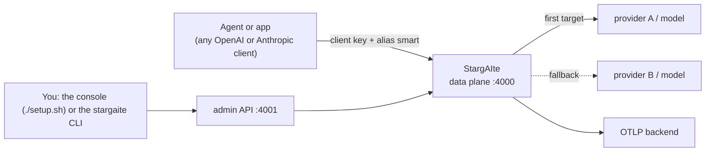
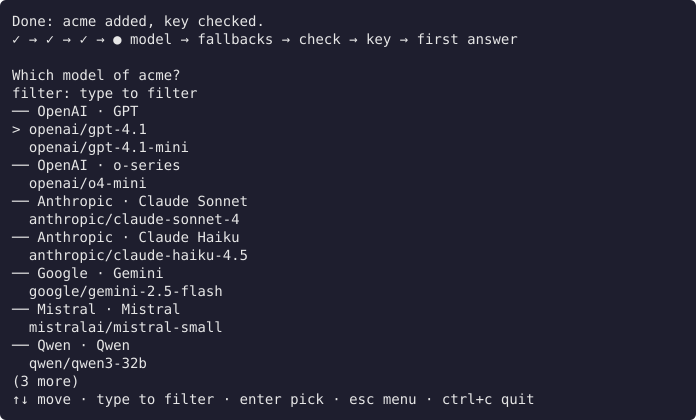
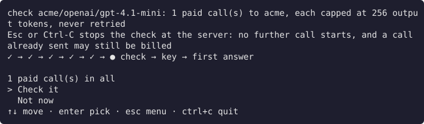
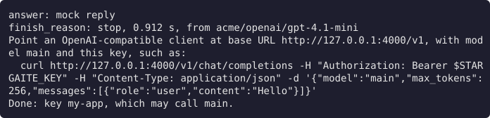
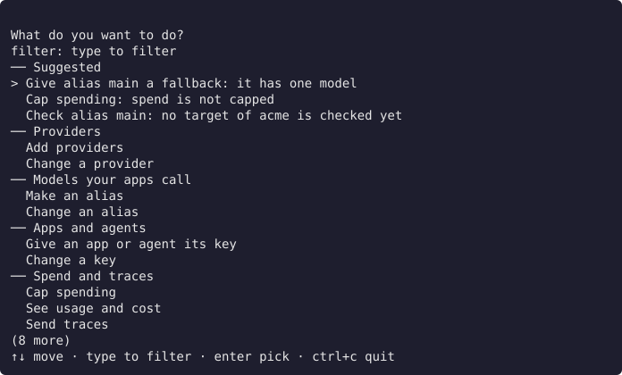

# StargAIte

**A small, self-hosted LLM inference proxy that tells the truth about what it sends.**

[](https://github.com/jorlaru/stargaite/actions/workflows/ci.yml)
[](LICENSE)

Your agents and applications call one OpenAI- or Anthropic-compatible endpoint with a model alias such as `smart`.
StargAIte resolves the alias to a provider and a model, translates the parameters that providers name differently,
falls back to the next model when one fails, counts what every call cost and refuses to spend past the limits you set.
It shows exactly what it sent, before and after. It is one static binary with one data directory, configured from a
guided console or its CLI; the proxy itself has no UI and no external database, and no change needs a restart.

## The problem it solves

- **Every consumer is coupled to a provider.** Changing a provider, an endpoint or a model means touching every agent,
  workflow and service that calls it. With StargAIte they call an alias, and what is behind it changes in one place.
- **Gateways rewrite requests in silence.** A gateway that drops a "not supported" parameter or injects an output cap
  nobody asked for is how a reasoning effort never reaches the provider, or how reasoning eats the cap and the answer
  comes back empty. StargAIte never changes a request without listing the change, and never sends an output cap that
  neither the client nor the alias asked for.
- **Traces show the intent, not what was sent.** StargAIte records the requested, the alias's and the sent value of
  every control, read from the final body that left for the provider.
- **Costs are guessed.** StargAIte takes the cost from the provider's own figure or from the prices you declare, and
  leaves it empty, flagged as unpriced, otherwise. A flat-fee subscription plan is metered in its own requests and
  tokens per window, never with an invented price.
- **Operating the gateway is a project of its own.** A UI, an external database and a restart for each change are
  more than many deployments need. StargAIte keeps its configuration and usage in an embedded store and publishes
  every change atomically, while requests keep flowing.

## What makes it different

| | |
|---|---|
| **The alias is a contract** | Clients name an alias; it lists up to three targets (provider and model) in order, its reasoning effort, output cap, limits and budget. Swap a target and no client changes. |
| **No silent changes** | Every parameter added, dropped or translated is listed in the `x-stargaite-params-changed` response header, the usage record and the span. `x-stargaite-target` and `x-stargaite-reasoning-effort` say who answered and with which effort. |
| **See it before you send it** | `stargaite models explain <alias>` prints the exact URL, headers (without the credential) and body each target would receive, without calling it. `stargaite targets verify <target>` calls the provider for real at each reasoning level and shows the tokens it spent. |
| **Reasoning effort under control** | One scale (`none` to `max`), translated into seven provider dialects (`reasoning_effort`, `reasoning: {effort}`, `thinking` toggles and budgets, Anthropic's adaptive effort). An alias sets its effort as a default the client may override, or forces it. |
| **Honest cost and hard limits** | Per key and per alias: requests and tokens per minute, requests in flight, USD budgets (daily, monthly or running) and shares of a subscription plan's windows. A request past any of them is refused before a provider is called. |
| **Telemetry that is easy to trust** | OTLP/HTTP spans to Langfuse, an OpenTelemetry Collector or any OTLP backend, with no vendor SDK. `stargaite telemetry test` sends a real span and names what failed. Prometheus metrics on the admin API. |
| **Small and fast** | A 26.5 MB image, 23 to 36 MB of memory at rest, under 0.5 ms of added median latency and 1,000 requests per second on one CPU ([docs/benchmark.md](docs/benchmark.md)). |
| **Built to be run by an agent too** | No `stargaite` command ever prompts; every one accepts `--json` and exits `0`, `1` or `2`. A whole configuration is exported and applied as YAML. `./setup.sh` opens a guided console at a terminal, and its subcommands take every answer as a flag. |
| **Safe defaults** | Listeners on loopback, TLS required beyond it, credentials referenced by environment variable and never stored, client keys stored as hashes, outbound addresses checked against private networks at every connection, online backups. |

**Endpoints.** `POST /v1/chat/completions` (OpenAI Chat Completions, synchronous and streamed, toward OpenAI-style
providers or translated to Anthropic's Messages API), `POST /v1/messages` (Anthropic Messages, thinking and tool loops
included), `POST /v1/embeddings`, `POST /v1/rerank` (Cohere, Jina, Voyage or TEI shapes, passed through) and
`GET /v1/models`. Any client that lets you set the base URL works unmodified: the official OpenAI and Anthropic SDKs,
workflow tools, `curl`.

**Providers.** Eighteen presets fill in the base URL, protocol, credential variable and billing for you: `openai`,
`anthropic`, `openrouter`, `deepinfra`, `minimax`, `zai`, `moonshot`, `dashscope`, `ollama`, `tei`, `deepseek`,
`gemini`, `xai`, `mistral`, `groq`, `together`, `fireworks` and `cerebras` (`stargaite providers presets` shows them,
with an `untested` mark on those not yet run against the live service). Any other OpenAI- or Anthropic-compatible
endpoint, local servers such as Ollama, vLLM or TEI included, is one `providers add` with `--protocol` and
`--base-url`. A preset used with another `--protocol` (MiniMax's Anthropic-format endpoint, say) keeps its credential
variable and billing but not the defaults it gives new targets, which are written for its own protocol: declare them
with `--target-defaults dialect=...`.

## How it works



Four kinds of resource, all managed with the CLI:

- **Provider**: where and how to call: base URL, protocol (`openai` or `anthropic`), the name of the environment
  variable that holds its credential, how it bills (`pay_per_use`, `subscription` or `none`), the parameters its
  models accept beyond the reference or refuse ([Parameters](docs/reference.md#parameters)), and, when it needs them,
  its own timeouts ([Resilience](docs/reference.md#resilience)).
- **Target**: one model of a provider, written `<provider>/<model>`, such as `openai/gpt-5-mini`, with its prices, its
  reasoning levels, what it can do, and the parameters it accepts or refuses where it differs from its provider.
- **Model alias**: the name clients send as `model`. It lists its targets, primary first, and may set an effort, an
  output cap, limits and a budget.
- **Key**: a client credential (`sk-stargaite-…`), shown once when created, allowed a list of aliases, with its own
  limits and budget. Keys are rotated and revoked without touching anything else.

The `stargaite` binary is both the server (`stargaite serve`) and its CLI, which talks to the admin API on
`127.0.0.1:4001` with the admin key that `serve` generates on its first start.

## Install

You need Linux (macOS and native Windows are not supported yet; WSL is Linux), Docker Engine with Docker Compose
2.24.4 or later and Docker's buildx component, `git`, and bash 4.4 or later, which every current distribution has. On
Debian or Ubuntu, one of the next two blocks installs them.

**As root** (a minimal Debian or Ubuntu, where `sudo` is not installed):

```sh
apt-get update && apt-get install -y ca-certificates curl git
curl -fsSL https://get.docker.com -o get-docker.sh && sh get-docker.sh
```

**As a user with `sudo`**:

```sh
sudo apt-get update && sudo apt-get install -y ca-certificates curl git
curl -fsSL https://get.docker.com -o get-docker.sh && sudo sh get-docker.sh
sudo usermod -aG docker "$USER"
```

Then log out and in again, so that your user may run Docker; membership of the `docker` group is equivalent to root.
The second line of each block runs Docker's own script, which adds Docker's package repository and installs Docker
Engine, Compose and buildx (`docker-buildx-plugin`); read it first if you like, and for a production machine follow
Docker's step-by-step instructions for [Debian](https://docs.docker.com/engine/install/debian/) or
[Ubuntu](https://docs.docker.com/engine/install/ubuntu/) instead. The distributions' own packages may lack Compose or
ship one older than 2.24.4; among Debian's own, buildx is `docker-buildx`. On another distribution, install
[Docker](https://docs.docker.com/engine/install/) and [git](https://git-scm.com/downloads) from their pages.

Then, as root or as that user:

```sh
git clone https://github.com/jorlaru/stargaite.git
cd stargaite
./setup.sh
```

`./setup.sh` first checks bash, refuses root in a clone that belongs to another user, then checks Docker, Compose
and buildx, in that order: it names the first that is missing, with where to get it, and installs nothing. It then
builds the console into `bin/stargaite-console`, when it is missing or of another version than the clone, and starts
it. To install without the console, see [Install with Docker by hand](docs/reference.md#install-with-docker-by-hand).

## The first run

When nothing is set up yet, the console opens its first run. It asks one step at a time under a step bar, each question
with its default, which Enter takes:

1. **Machine.** The data plane goes on `127.0.0.1:4000`; when that port is taken, it offers the next free one. The
   container is built and started; the first build takes a few minutes.
2. **Provider.** One or more, picked at once from the presets, or another OpenAI- or Anthropic-compatible service by
   its URL. Each key is typed hidden, checked for free (its model list) and written only to `.env` (mode `0600`);
   the container is then recreated once to read them, after you confirm it: that question starts on No, so press ↑,
   then Enter. A server on this host, such as Ollama, is reached from the container at `host.docker.internal`, so it
   must listen beyond the host's loopback (Ollama: `OLLAMA_HOST=0.0.0.0`).
3. **Alias.** The name your clients send as the model: `main`.
4. **Model.** Picked from the provider's own list, grouped by vendor and family, chat models only unless you ask for
   every one; typing filters it, or type a model id.



5. **Fallbacks.** Up to two, from the providers already added, tried in order when the model fails.
6. **Check.** Paid calls to each new model: one per reasoning level it declares, one more at `none` when it can turn
   reasoning off, or a single one when it declares neither; a model already checked is not checked again. A failure
   says the provider's reason and stops there.



7. **Key.** A client key for the alias (`my-app`, 60 requests a minute), shown once on a screen of its own, which
   leaves no copy in the terminal's history, until Enter says "I have stored it".
8. **First answer.** One paid chat completion with that key, then the base URL and an example call with `max_tokens`.



**Paid calls.** Only the check and the first answer call a provider for money. Each states its count first and waits
for Check it or Try it, or Not now; an Enter typed before the step has been on screen for 400 ms, or a paste, does not
pay. Esc or Ctrl-C stops a check or a try at the server: no further call starts, and one already sent may still be
billed. Each call is capped at 256 output tokens and never retried, and one console run makes at most 12. Prices are
asked only when a budget needs them.

Interrupted, the first run resumes at its first missing step when run again: what exists is kept, never made twice.
It ends on the home. `./setup.sh status` prints what exists: providers and their credentials, aliases with their
models in order, keys, budgets, telemetry and both versions.

## The home

Run again, `./setup.sh` opens the home: a summary line, the result of the last task, then **What do you want to do?**,
with suggestions first and every task by group. The list fits the terminal's height and scrolls.



The summary line, above the list, reads after a first run
`<base URL>: ready · proxy <v> · clone <v> · 1 provider(s), 1 alias(es), 1 key(s)`, then ` · spend not capped` while
no budget caps the whole instance. The tasks:

| Group | Tasks |
|---|---|
| Providers | Add providers · Change a provider |
| Models your apps call | Make an alias · Change an alias |
| Apps and agents | Give an app or agent its key · Change a key |
| Spend and traces | Cap spending · See usage and cost · Send traces |
| This machine | See what exists · Open to the network · Upgrade · Back up or restore · See logs · Stop or start · Check everything · Uninstall |

↑ and ↓ move, typing filters, Enter picks. Esc leaves a task for the home, which says `Left <task>.`; Ctrl-C quits.
A task says every change before it makes it; a change that replaces something or interrupts traffic is confirmed
first. A paid step comes after the questions, with its own Check it or Try it.

## Scripts and agents

Each task with a subcommand also runs without a terminal, every answer given as a flag; `./setup.sh help` lists each
one's flags:

| Subcommand | What it does |
|---|---|
| `install` | The first run above; the default at a terminal before anything is set up |
| `provider` | Add providers and their keys in one go; each key is checked for free (its model list) before it is written to `.env`, and the container is recreated once |
| `alias` | An alias toward a provider's model, with fallbacks from any provider; its new targets are checked first, each paid call announced |
| `key` | A client key for one or more aliases, shown once, then one test call through it, announced first |
| `budget` | The console's Cap spending: a limit on the instance, an alias or a key; the prices of the targets it reaches unpriced are asked first, and a target they leave unverified is checked again, paid, only at a terminal or with `--reverify` |
| `telemetry` | The console's Send traces: to Langfuse or any OTLP endpoint, replacing what was set whole, then one free test span; `--backend off` turns traces off |
| `remote` | The console's Open to the network: publish the data plane beyond loopback, always with TLS, your certificate or a self-signed one it makes; run again, it renews it ([Install with Docker by hand](docs/reference.md#install-with-docker-by-hand), day two) |
| `status` | What exists: providers and their credentials, aliases with their models in order, models in no alias, keys, budgets, telemetry, and the running and the clone's versions; `--check` first says whether an upgrade is available |
| `logs` | The container's last log lines; at a terminal it then follows them until Esc |
| `stop`, `start`, `restart` | The container; stop and restart need `--yes` without a terminal |
| `backup`, `restore` | A copy of the store into `backups/`; restore puts a copy back (`--from <file>`, `--yes`): keys revoked since come back, spend since is forgotten, and the container is stopped and started again |
| `uninstall` | The container, its images and the console; the volume, `.env`, the override, `backups/` and `tls/` are kept (`--yes`) |
| `upgrade` | The console's Upgrade: fast-forward the clone and rebuild, keeping the previous image and taking a backup first, printing the way back before the new version starts; `--rebuild` rebuilds this clone's version without fetching; at a terminal the console then restarts as the new version |

It asks only when its standard input and output are both a terminal. Every answer is also a flag, so a script, CI or an
agent runs it without one: an answer with a default takes it, a missing one exits `2` naming its flag, and a change
that replaces something or briefly interrupts traffic needs `--yes`. Naming a task that pays is the consent: it prints
its count of paid calls, then makes them; a model already checked is checked again only with `--reverify`. A
credential then comes from a variable you have exported, named by `--key-env` (here `OPENROUTER_API_KEY`), never from
the command line. Run the first line alone and type the key, which it reads hidden, so it never reaches your shell
history:

```sh
printf 'Key: '; read -rs OPENROUTER_API_KEY; echo; export OPENROUTER_API_KEY
```

Then the install, with your model id in place of `<model>`, and the key taken out of the shell's environment after:

```sh
./setup.sh install --provider openrouter --key-env OPENROUTER_API_KEY --model <model> --yes
unset OPENROUTER_API_KEY
```

It exits `0` when done, `1` on a failure it explains and `2` on a wrong usage. Besides `.env` it writes only
`compose.override.yaml` (for a local server or `remote`, and never one it did not write), `tls/`, `backups/` and
`bin/stargaite-console`, all ignored by git and by the image build; it never edits `compose.yaml`, never uses `sudo`
and never removes a volume. Change a provider, Change an alias, Change a key, See usage and cost and Check everything
have no subcommand: run them from the home, or do the same with the `stargaite` CLI.

## The stargaite CLI

The console changes the proxy's configuration only through the `stargaite` CLI inside the container, which never
prompts; its machine tasks (the container, `.env`, the TLS files, upgrades) work on the host, with Docker and git. Run
the CLI yourself from the clone, where `compose.yaml` is, through this shell alias; `-T` lets a file of the host reach
it on standard input, as `-`:

```sh
alias stargaite='docker compose exec -T stargaite /stargaite'
```

Once Open to the network has turned TLS on, use the alias it prints instead. The CLI also does what the console does
not offer: embeddings and rerank aliases (the console adds chat models only), parameter rules, a key's content in
traces, the instance's limits and timeouts, and saving or applying the whole configuration as YAML.
`stargaite --help` lists every command, and `stargaite <command> --help` its flags.

| Task | Command |
|---|---|
| List the provider presets | `stargaite providers presets` |
| Add a provider from a preset, or any compatible endpoint | `stargaite providers add openrouter` · `stargaite providers add local --protocol openai --base-url http://127.0.0.1:8000/v1 --allow-private-network --billing none` |
| Add a fallback model to an alias | `stargaite targets add anthropic/<model> --kind chat`, then `stargaite models set smart --target openai/<model> --target anthropic/<model> --max-output-tokens 8192` |
| See what an alias would send | `stargaite models explain smart` · `stargaite models explain smart --effort none` · `stargaite models explain smart --body - < request.json` · `stargaite models explain embed --endpoint embeddings` |
| Let a provider's own parameter through, or remove one | `stargaite providers set openrouter --param provider=forward` · `stargaite targets set anthropic/<model> --param temperature=drop` |
| Give a slow provider its own timeout | `stargaite providers set local --total-ms 600000` · `stargaite providers set local --total-ms=` |
| Declare a target's reasoning levels | `stargaite targets set openai/<model> --level low --level medium --level high --can-disable=false` |
| Create, rotate and revoke a client key | `stargaite keys create my-app --model smart` · `stargaite keys rotate my-app` · `stargaite keys revoke my-app --yes` |
| Limit and budget a key | `stargaite keys set my-app --rpm-limit 60 --max-parallel-requests 4 --budget limit_usd=10,reset_interval=daily` |
| Meter a subscription plan | `stargaite providers set <name> --billing subscription --quota 5h:requests=1000` · `stargaite usage quota` |
| See usage and cost | `./setup.sh`, then See usage and cost, a table by key, alias or target · `stargaite usage show --since 24h --by key,model` |
| Send traces to Langfuse | `stargaite telemetry set --preset langfuse --otlp-endpoint https://<host>/api/public/otel` · `stargaite telemetry test` |
| Check the whole configuration | `./setup.sh`, then Check everything · `stargaite validate` |
| Save and apply the configuration as YAML | `stargaite export > config.yaml` · `stargaite apply -f - --dry-run < config.yaml` · `stargaite apply -f - < config.yaml` |
| Back up the store, and put a backup back with `serve` stopped | `./setup.sh backup` · `./setup.sh restore --from <file> --yes` · `stargaite backup <file>` · `(umask 077 && stargaite backup - > backup.db)` · `stargaite restore backup.db --yes` ([Backup and restore](docs/reference.md#backup-and-restore)) |

Every command accepts `--json`, never prompts, and exits `0` on success, `1` on failure and `2` on wrong usage;
`remove`, `keys revoke`, `telemetry unset`, `restore` and `apply --prune` (unless `--dry-run`) need `--yes`. Where a
command reads a file (`apply -f`, `validate -f`, `models explain --body`, `restore`), and only there, `-` reads standard
input, never a terminal; `backup -` writes the copy to standard output, never a terminal. A pipe cut short is
still valid YAML, and `apply` replaces each resource it names whole, so `apply -f -` publishes only a document whose
last line is the YAML end marker `...`, which `export` writes, and exits `2` on any other (a JSON document, which a cut
leaves unclosed, needs none); `--dry-run` and `validate -f -` need no marker. `apply -f - --prune` exits `2` unless it
is a `--dry-run`: prune from a file. Each change is published atomically, at a new revision, and audited; requests in
flight finish on the configuration they started with.

## Connect your clients

Any OpenAI- or Anthropic-compatible client works by changing three things: the base URL, the API key (an
`sk-stargaite-…` key) and the model (an alias).

```python
from openai import OpenAI

client = OpenAI(base_url="http://127.0.0.1:4000/v1", api_key="sk-stargaite-...")
reply = client.chat.completions.create(model="smart", messages=[{"role": "user", "content": "Hello"}])
print(reply.choices[0].message.content)
```

```python
from anthropic import Anthropic

client = Anthropic(base_url="http://127.0.0.1:4000", api_key="sk-stargaite-...")
reply = client.messages.create(model="claude", max_tokens=1024, messages=[{"role": "user", "content": "Hello"}])
print(reply.content[0].text)
```

```sh
curl http://127.0.0.1:4000/v1/chat/completions -H "Authorization: Bearer sk-stargaite-..." \
  -d '{"model":"smart","messages":[{"role":"user","content":"Hello"}],"stream":true}'
```

The Anthropic example needs an alias with an `anthropic` target, such as
`stargaite providers add anthropic` and
`stargaite models add claude --target anthropic/<model> --max-output-tokens 8192`. Streaming, tools, structured output
and reasoning effort (`reasoning_effort` on chat completions, `output_config.effort` on messages) pass through as the
alias allows. Every answer carries `x-stargaite-request-id`, `x-stargaite-target` (who answered),
`x-stargaite-trace-id`, and, when they apply, `x-stargaite-reasoning-effort` (the effort sent) and
`x-stargaite-params-changed` (what the proxy changed). An error names its cause in `x-stargaite-error-code`, such as
`rate_limit_exceeded` or `budget_exceeded`.

## Upgrade, back up and uninstall

**Upgrade.** Upgrade, or `./setup.sh upgrade`, refuses a clone with local changes to tracked files, a detached
`HEAD`, a branch without upstream and one that cannot fast-forward, naming which. It fetches, lists the new commits
and says whether a migration of the store changed; once confirmed it tags the running image `<image>-previous`,
fast-forwards the clone, builds the new image, backs the store up into `backups/` just before it starts the new
version, and prints the way back before that start: the `restore` of that backup and the `docker tag` of the previous
image. Nothing rolls back by itself, since a migration may be one-way. `./setup.sh upgrade --rebuild` rebuilds the
clone's own version without fetching. At a terminal the console then restarts as the new version.
`./setup.sh status --check` says whether an upgrade is available. The steps by hand are in
[Install with Docker by hand](docs/reference.md#install-with-docker-by-hand), day two.

**Back up and restore.** Back up or restore, or `./setup.sh backup`, writes a checked copy of the store, taken while
traffic flows, into `backups/` with mode `0600`. `./setup.sh restore --from <file> --yes` stops the container, puts
the copy back with the current image and starts it again: keys revoked since come back, and spend since is forgotten
([Backup and restore](docs/reference.md#backup-and-restore)).

**Reach it from other machines.** Open to the network, or `./setup.sh remote`, publishes the data plane on the
addresses of this host you give, beside loopback, always with TLS: your certificate and its key, or a self-signed
certificate it makes; it never publishes plain HTTP beyond loopback. Run again, it renews it. Docker publishes past
`ufw` and `firewalld`, so limit the port in your network's firewall
([Listeners, TLS and the container](docs/reference.md#listeners-tls-and-the-container)).

**Uninstall.** Uninstall, or `./setup.sh uninstall --yes`, removes the container and its network, the images
`<image>` and `<image>-previous` and `bin/stargaite-console`. It keeps the volume, which holds the store (keys,
configuration and usage), `.env`, `compose.override.yaml`, `backups/` and `tls/`, and prints the commands that remove
them; `./setup.sh` installs again on the kept volume.

## Try it locally with Go

Try every feature in a few minutes, with no account and no credential: the mock provider in `tests/mockprovider`
stands in for a real one. You need a clone of this repository and Go 1.27.4 or later (to deploy it with Docker, see
[Install](#install), or [Install with Docker by hand](docs/reference.md#install-with-docker-by-hand)). Run the block line by line from
the clone; `tests/e2e` runs exactly these lines in `make ci`, so they work as written.

```sh
go build -o stargaite ./cmd/stargaite
go run ./tests/mockprovider/cmd/mockprovider &
./stargaite serve &
curl -sS --retry 10 --retry-connrefused --retry-delay 1 http://127.0.0.1:4000/health/ready
./stargaite providers add mock --protocol openai --base-url http://127.0.0.1:4010 --allow-private-network --billing pay_per_use
./stargaite models add fast --target mock/mock
./stargaite targets set mock/mock --pricing input_per_million=1,output_per_million=2,as_of=2026-11-01
./stargaite targets add mock/mock-embed --kind embeddings --pricing input_per_million=1,output_per_million=0,as_of=2026-11-01
./stargaite models add embed --target mock/mock-embed
./stargaite keys create my-agent --model fast --model embed --rpm-limit 60
./stargaite models explain fast
./stargaite targets verify mock/mock
./stargaite telemetry set --otlp-endpoint http://127.0.0.1:4010 --allow-private-network
./stargaite telemetry test
curl -s http://127.0.0.1:4000/v1/models -H "Authorization: Bearer sk-stargaite-..."
curl -s http://127.0.0.1:4000/v1/chat/completions -H "Authorization: Bearer sk-stargaite-..." -d '{"model":"fast","messages":[{"role":"user","content":"hi"}]}'
curl -s http://127.0.0.1:4000/v1/embeddings -H "Authorization: Bearer sk-stargaite-..." -d '{"model":"embed","input":"hi"}'
curl -s http://127.0.0.1:4001/admin/v1/metrics -H "Authorization: Bearer $(cat data/admin.key)"
./stargaite usage show --since 1h --by model
./stargaite backup backup.db
```

What each step does:

1. **Start.** The mock provider listens on `127.0.0.1:4010`. `serve` puts the data plane on `127.0.0.1:4000`, the
   admin API on `127.0.0.1:4001` and everything else in `./data`, including the admin key it generates on its first
   start (`data/admin.key`, which the CLI reads). The health check waits until it is up.
2. **Configure.** `providers add` declares the mock as a provider billed per use. `models add fast` creates the alias
   `fast` and its target `mock/mock`, warning that the target has no prices yet; `targets set` gives it prices in USD
   per million input and output tokens. `targets add` and `models add embed` do the same for an embeddings model.
3. **Issue a key.** `keys create` allows the key both aliases, limits it to 60 requests a minute and prints the client
   key once: paste it in place of `sk-stargaite-...` in the three `curl` calls.
4. **Look before sending.** `models explain fast` prints, per target, the effort and output-cap decisions, the list of
   changes, the URL, the headers without the credential and the exact body the chat completion below will send.
   `targets verify` calls the target for real and stores the result (see [Targets verify](docs/reference.md#targets-verify)).
5. **Connect telemetry.** `telemetry set` points the OTLP exporter at the mock, which also accepts traces, and
   `telemetry test` sends one span and prints
   `credentials: resolved · reachable: yes · authorized: yes · span: accepted (200) · trace_id=…`.
6. **Call it.** The first `curl` lists the aliases `embed` and `fast`; the second gets the mock's chat answer, with the
   headers `x-stargaite-request-id`, `x-stargaite-trace-id` and `x-stargaite-target` (add `-i` to see them); the third
   gets the mock's embedding vector, byte for byte. The fourth reads the Prometheus metrics with the admin key, such as
   `stargaite_requests_total{key="my-agent",model="fast",status="200"} 1`.
7. **Account and back up.** `usage show --by model` sums the last hour per alias: for `fast` one request, 1 input and
   2 output tokens and 0.000005 USD; for `embed` one request and 0.000001 USD; and, under the alias `-`, the verify
   call, recorded under the key `_verify`. `backup` writes a checked copy of the store to `backup.db` with mode `0600`.

Both processes log JSON lines to the terminal; `kill %1 %2` stops them. `./stargaite --help` lists every command, and
`./stargaite <command> --help` its flags.

## Status

Phases 1 to 7 of the specification are built: every feature above works and is tested (`make ci`, and
`make setup-test` for `setup.sh` and the console), and the figures of [docs/benchmark.md](docs/benchmark.md) are
measured. No release is tagged and no image is published yet, so build it from this repository. Presets marked
`untested` have not been run against their live service. The specification is [kick-off.md](kick-off.md) and the
designs of each phase are in [docs/design](docs/design); what changed for a reader is in
[docs/changes.md](docs/changes.md), every detail in [docs/reference.md](docs/reference.md), and how it is built and
tested in [docs/development.md](docs/development.md).

## License

MIT: see [LICENSE](LICENSE).
