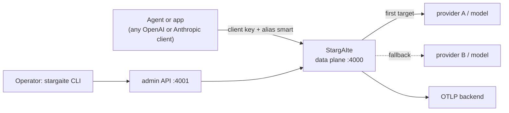

# StargAIte

**A small, self-hosted LLM inference proxy that tells the truth about what it sends.**

[](https://github.com/jorlaru/stargaite/actions/workflows/ci.yml)
[](LICENSE)

Your agents and applications call one OpenAI- or Anthropic-compatible endpoint with a model alias such as `smart`.
StargAIte resolves the alias to a provider and a model, translates the parameters that providers name differently,
falls back to the next model when one fails, counts what every call cost and refuses to spend past the limits you set.
It shows exactly what it sent, before and after. It is one static binary with one data directory, configured from
its CLI: no UI, no external database, no restart to change anything.

## The problem it solves

- **Every consumer is coupled to a provider.** Changing a provider, an endpoint or a model means touching every agent,
  workflow and service that calls it. With StargAIte they call an alias, and what is behind it changes in one place.
- **Gateways rewrite requests in silence.** A gateway that drops a "not supported" parameter or injects an output cap
  nobody asked for is how a reasoning effort never reaches the provider, or how reasoning eats the cap and the answer
  comes back empty. StargAIte never changes a request without listing the change, and never sends an output cap that
  neither the client nor the alias asked for.
- **Traces show the intent, not what was sent.** StargAIte records the requested, the alias's and the sent value of
  every control, read from the final body that left for the provider.
- **Costs are guessed.** StargAIte takes the cost from the provider's own figure or from the prices you declare, and
  leaves it empty, flagged as unpriced, otherwise. A flat-fee subscription plan is metered in its own requests and
  tokens per window, never with an invented price.
- **Operating the gateway is a project of its own.** A UI, an external database and a restart for each change are
  more than many deployments need. StargAIte keeps its configuration and usage in an embedded store and publishes
  every change atomically, while requests keep flowing.

## What makes it different

| | |
|---|---|
| **The alias is a contract** | Clients name an alias; it lists up to three targets (provider and model) in order, its reasoning effort, output cap, limits and budget. Swap a target and no client changes. |
| **No silent changes** | Every parameter added, dropped or translated is listed in the `x-stargaite-params-changed` response header, the usage record and the span. `x-stargaite-target` and `x-stargaite-reasoning-effort` say who answered and with which effort. |
| **See it before you send it** | `stargaite models explain <alias>` prints the exact URL, headers (without the credential) and body each target would receive, without calling it. `stargaite targets verify <target>` calls the provider for real at each reasoning level and shows the tokens it spent. |
| **Reasoning effort under control** | One scale (`none` to `max`), translated into seven provider dialects (`reasoning_effort`, `reasoning: {effort}`, `thinking` toggles and budgets, Anthropic's adaptive effort). An alias sets its effort as a default the client may override, or forces it. |
| **Honest cost and hard limits** | Per key and per alias: requests and tokens per minute, requests in flight, USD budgets (daily, monthly or running) and shares of a subscription plan's windows. A request past any of them is refused before a provider is called. |
| **Telemetry that is easy to trust** | OTLP/HTTP spans to Langfuse, an OpenTelemetry Collector or any OTLP backend, with no vendor SDK. `stargaite telemetry test` sends a real span and names what failed. Prometheus metrics on the admin API. |
| **Small and fast** | A 26.5 MB image, 23 to 36 MB of memory at rest, under 0.5 ms of added median latency and 1,000 requests per second on one CPU ([docs/benchmark.md](docs/benchmark.md)). |
| **Built to be run by an agent too** | No `stargaite` command ever prompts; every one accepts `--json` and exits `0`, `1` or `2`. A whole configuration is exported and applied as YAML. `./setup.sh`, the guided installer, asks only at a terminal and takes every answer as a flag. |
| **Safe defaults** | Listeners on loopback, TLS required beyond it, credentials referenced by environment variable and never stored, client keys stored as hashes, outbound addresses checked against private networks at every connection, online backups. |

**Endpoints.** `POST /v1/chat/completions` (OpenAI Chat Completions, synchronous and streamed, toward OpenAI-style
providers or translated to Anthropic's Messages API), `POST /v1/messages` (Anthropic Messages, thinking and tool loops
included), `POST /v1/embeddings`, `POST /v1/rerank` (Cohere, Jina, Voyage or TEI shapes, passed through) and
`GET /v1/models`. Any client that lets you set the base URL works unmodified: the official OpenAI and Anthropic SDKs,
workflow tools, `curl`.

**Providers.** Eighteen presets fill in the base URL, protocol, credential variable and billing for you: `openai`,
`anthropic`, `openrouter`, `deepinfra`, `minimax`, `zai`, `moonshot`, `dashscope`, `ollama`, `tei`, `deepseek`,
`gemini`, `xai`, `mistral`, `groq`, `together`, `fireworks` and `cerebras` (`stargaite providers presets` shows them,
with an `untested` mark on those not yet run against the live service). Any other OpenAI- or Anthropic-compatible
endpoint, local servers such as Ollama, vLLM or TEI included, is one `providers add` with `--protocol` and
`--base-url`. A preset used with another `--protocol` (MiniMax's Anthropic-format endpoint, say) keeps its credential
variable and billing but not the defaults it gives new targets, which are written for its own protocol: declare them
with `--target-defaults dialect=...`.

## How it works



Four kinds of resource, all managed with the CLI:

- **Provider**: where and how to call: base URL, protocol (`openai` or `anthropic`), the name of the environment
  variable that holds its credential, how it bills (`pay_per_use`, `subscription` or `none`), the parameters its
  models accept beyond the reference or refuse ([Parameters](#parameters)), and, when it needs them, its own timeouts
  ([Resilience](#resilience)).
- **Target**: one model of a provider, written `<provider>/<model>`, such as `openai/gpt-5-mini`, with its prices, its
  reasoning levels, what it can do, and the parameters it accepts or refuses where it differs from its provider.
- **Model alias**: the name clients send as `model`. It lists its targets, primary first, and may set an effort, an
  output cap, limits and a budget.
- **Key**: a client credential (`sk-stargaite-…`), shown once when created, allowed a list of aliases, with its own
  limits and budget. Keys are rotated and revoked without touching anything else.

The `stargaite` binary is both the server (`stargaite serve`) and its CLI, which talks to the admin API on
`127.0.0.1:4001` with the admin key that `serve` generates on its first start.

## Install

`./setup.sh` installs StargAIte on Linux with Docker by asking questions: it checks the machine, builds and starts the
container, and goes from a provider to a client key and a first answer. You need:

- Docker Engine with Docker Compose 2.24.4 or later, which your user may run;
- `curl` and `jq`;
- `git`, to clone this repository and, later, to upgrade;
- bash 4.4 or later, which every current Linux distribution has. macOS and native Windows are not supported yet; WSL
  is Linux.

On Debian and Ubuntu:

```sh
sudo apt-get update && sudo apt-get install -y ca-certificates curl git jq
curl -fsSL https://get.docker.com -o get-docker.sh && sudo sh get-docker.sh
sudo usermod -aG docker "$USER"
```

As root, where `sudo` may not be installed, leave out `sudo` and the third line. The second line runs Docker's own
script, which adds Docker's package repository and installs Docker Engine and Compose; read it first if you like, and
for a production machine follow Docker's step-by-step instructions for
[Debian](https://docs.docker.com/engine/install/debian/) or [Ubuntu](https://docs.docker.com/engine/install/ubuntu/)
instead. The distributions' own packages may lack Compose or ship one older than 2.24.4. The third line lets your user
run Docker once you log in again; membership of the `docker` group is equivalent to root. On another distribution,
install [Docker](https://docs.docker.com/engine/install/), [curl](https://curl.se/download.html),
[jq](https://jqlang.org/download/) and [git](https://git-scm.com/downloads) from their pages. Then, as the user
who owns the clone (not with `sudo`):

```sh
git clone https://github.com/jorlaru/stargaite.git
cd stargaite
./setup.sh
```

It reports everything missing at once, with where to get it, and installs nothing. Then it asks, each question with its
default in brackets, which Enter takes:

1. **The machine.** The data plane goes on `127.0.0.1:4000`; when that port is taken, `--port <n>` picks another.
   The container is built and started (a few minutes the first time).
2. **A provider.** A preset from a numbered list, or another OpenAI- or Anthropic-compatible service by its URL. Its
   credential is typed hidden and written only to `.env` (mode `0600`), never shown; the container is recreated to
   read it. A server on this host, such as Ollama, is reached from the container at `host.docker.internal`, so it must
   listen beyond the host's loopback (Ollama: `OLLAMA_HOST=0.0.0.0`).
3. **A model.** Offered from the provider's own list (one free request), filtered by what you type, or typed.
4. **The check.** `targets verify` calls the model for real (see [Targets verify](#targets-verify)); a failure prints
   the provider's reason and stops before anything else is made.
5. **An alias and a key.** The alias your clients call (`main`) and a client key (`my-app`, 60 requests a minute),
   printed once, inside a frame, and written nowhere: store it then.
6. **A first answer.** One chat completion with that key, then the base URL and an example call.

It makes two kinds of paid call, each announced first with its count, capped at 256 output tokens and never retried:
`targets verify` (one call per reasoning level the target declares), skipped for a target already verified, and the
test chat completion. Interrupted, it resumes when run again: what exists is kept, never made twice.

Run again on an installation, it offers a menu, or takes a subcommand; `./setup.sh help` lists each one's flags:

| Subcommand | What it does |
|---|---|
| `install` | The steps above; the default at a terminal before the container exists |
| `provider` | Add a provider and its credential, or replace a credential in `.env` |
| `alias` | An alias toward a provider's model, the target verified first |
| `key` | A client key for an alias, then a first answer with it |
| `budget` | A spending limit on the instance, an alias or a key; the prices of the targets it reaches unpriced are asked first |
| `telemetry` | Traces to Langfuse or any OTLP endpoint, then `telemetry test` |
| `remote` | Publish the data plane beyond loopback, always with TLS: your certificate or a self-signed one ([Install with Docker by hand](#install-with-docker-by-hand), day two) |
| `status` | The running and the clone's versions and each credential's state; `--check` also says whether an upgrade is available |
| `upgrade` | Fast-forward the clone and rebuild, keeping the previous image and taking a backup first, then print the way back |

It asks only when its standard input and output are both a terminal. Every answer is also a flag, so a script, CI or an
agent runs it without one: an answer with a default takes it, a missing one exits `2` naming its flag, and a change
that replaces something or briefly interrupts traffic needs `--yes`. A credential then comes from a variable you have
exported, named by `--key-env` (here `OPENROUTER_API_KEY`), never from the command line. Run the first line alone and
type the key, which it reads hidden, so it never reaches your shell history:

```sh
printf 'Key: '; read -rs OPENROUTER_API_KEY; echo; export OPENROUTER_API_KEY
```

Then the install, with your model id in place of `<model>`, and the key taken out of the shell's environment after:

```sh
./setup.sh install --provider openrouter --key-env OPENROUTER_API_KEY --model <model> --yes
unset OPENROUTER_API_KEY
```

It exits `0` when done, `1` on a failure it explains and `2` on a wrong usage. Besides `.env` it writes only
`compose.override.yaml` (for a local server or `remote`, and never one it did not write), `tls/` and `backups/`, all
ignored by git and by the image build; it never edits `compose.yaml`, never uses `sudo` and never removes a volume.
To run the CLI yourself, see the shell alias of [Install with Docker by hand](#install-with-docker-by-hand).

## Try it locally with Go

Try every feature in a few minutes, with no account and no credential: the mock provider in `tests/mockprovider`
stands in for a real one. You need a clone of this repository and Go 1.27.4 or later (to deploy it with Docker, see
[Install](#install), or [Install with Docker by hand](#install-with-docker-by-hand)). Run the block line by line from
the clone; `tests/e2e` runs exactly these lines in `make ci`, so they work as written.

```sh
go build -o stargaite ./cmd/stargaite
go run ./tests/mockprovider/cmd/mockprovider &
./stargaite serve &
curl -sS --retry 10 --retry-connrefused --retry-delay 1 http://127.0.0.1:4000/health/ready
./stargaite providers add mock --protocol openai --base-url http://127.0.0.1:4010 --allow-private-network --billing pay_per_use
./stargaite models add fast --target mock/mock
./stargaite targets set mock/mock --pricing input_per_million=1,output_per_million=2,as_of=2026-11-01
./stargaite targets add mock/mock-embed --kind embeddings --pricing input_per_million=1,output_per_million=0,as_of=2026-11-01
./stargaite models add embed --target mock/mock-embed
./stargaite keys create my-agent --model fast --model embed --rpm-limit 60
./stargaite models explain fast
./stargaite targets verify mock/mock
./stargaite telemetry set --otlp-endpoint http://127.0.0.1:4010 --allow-private-network
./stargaite telemetry test
curl -s http://127.0.0.1:4000/v1/models -H "Authorization: Bearer sk-stargaite-..."
curl -s http://127.0.0.1:4000/v1/chat/completions -H "Authorization: Bearer sk-stargaite-..." -d '{"model":"fast","messages":[{"role":"user","content":"hi"}]}'
curl -s http://127.0.0.1:4000/v1/embeddings -H "Authorization: Bearer sk-stargaite-..." -d '{"model":"embed","input":"hi"}'
curl -s http://127.0.0.1:4001/admin/v1/metrics -H "Authorization: Bearer $(cat data/admin.key)"
./stargaite usage show --since 1h --by model
./stargaite backup backup.db
```

What each step does:

1. **Start.** The mock provider listens on `127.0.0.1:4010`. `serve` puts the data plane on `127.0.0.1:4000`, the
   admin API on `127.0.0.1:4001` and everything else in `./data`, including the admin key it generates on its first
   start (`data/admin.key`, which the CLI reads). The health check waits until it is up.
2. **Configure.** `providers add` declares the mock as a provider billed per use. `models add fast` creates the alias
   `fast` and its target `mock/mock`, warning that the target has no prices yet; `targets set` gives it prices in USD
   per million input and output tokens. `targets add` and `models add embed` do the same for an embeddings model.
3. **Issue a key.** `keys create` allows the key both aliases, limits it to 60 requests a minute and prints the client
   key once: paste it in place of `sk-stargaite-...` in the three `curl` calls.
4. **Look before sending.** `models explain fast` prints, per target, the effort and output-cap decisions, the list of
   changes, the URL, the headers without the credential and the exact body the chat completion below will send.
   `targets verify` calls the target for real and stores the result (see [Targets verify](#targets-verify)).
5. **Connect telemetry.** `telemetry set` points the OTLP exporter at the mock, which also accepts traces, and
   `telemetry test` sends one span and prints
   `credentials: resolved · reachable: yes · authorized: yes · span: accepted (200) · trace_id=…`.
6. **Call it.** The first `curl` lists the aliases `embed` and `fast`; the second gets the mock's chat answer, with the
   headers `x-stargaite-request-id`, `x-stargaite-trace-id` and `x-stargaite-target` (add `-i` to see them); the third
   gets the mock's embedding vector, byte for byte. The fourth reads the Prometheus metrics with the admin key, such as
   `stargaite_requests_total{key="my-agent",model="fast",status="200"} 1`.
7. **Account and back up.** `usage show --by model` sums the last hour per alias: for `fast` one request, 1 input and
   2 output tokens and 0.000005 USD; for `embed` one request and 0.000001 USD; and, under the alias `-`, the verify
   call, recorded under the key `_verify`. `backup` writes a checked copy of the store to `backup.db` with mode `0600`.

Both processes log JSON lines to the terminal; `kill %1 %2` stops them. `./stargaite --help` lists every command, and
`./stargaite <command> --help` its flags.

## Install with Docker by hand

What `./setup.sh` does, step by step without it. The image is built from this repository: a static binary on a
distroless base, run as a non-root user on a read-only root file system, with its data on a volume. You need Docker
with Compose 2.24.4 or later, curl and git ([Install](#install) has the commands).

**1. Get the code and add your provider credentials.** Credentials go in a file named `.env` next to `compose.yaml`,
one `NAME='value'` line per credential, using the variable names of the presets (`OPENAI_API_KEY`,
`ANTHROPIC_API_KEY`, `OPENROUTER_API_KEY`, …; `providers presets` lists them all). Git and the image build both
ignore `.env`. The last line below, in bash or zsh alike, reads the key without showing it and appends its line, so
the key never reaches your shell history or a command's arguments; run it once per credential, with that
credential's variable name in place of `OPENAI_API_KEY`. The single quotes let the value hold `$`, `#` and spaces;
it may not hold a `'`, nor end in `\`, which Compose cannot read:

```sh
git clone https://github.com/jorlaru/stargaite.git
cd stargaite
touch .env && chmod 600 .env
printf 'Key: '; read -rs k; echo; [ -n "$k" ] && printf "OPENAI_API_KEY='%s'\n" "$k" >> .env; unset k
```

**2. Start it.**

```sh
export STARGAITE_VERSION=$(git describe --tags --always --dirty)
docker compose up -d --build
curl -sS --retry 10 --retry-all-errors --retry-delay 1 http://127.0.0.1:4000/health/ready
```

`STARGAITE_VERSION` gives the build the clone's version, which `stargaite version` then reports; without it, the
version is `dev`. The data plane is published on `127.0.0.1:4000` of the host; a line `STARGAITE_PORT='<n>'` in
`.env` publishes it on another port, and `STARGAITE_IMAGE` names the image (`stargaite:local` by default). The admin
API never leaves the container; the CLI inside it administers the proxy with the admin key generated in the volume. A
shell alias saves typing (run it from the clone, where `compose.yaml` is); `-T` lets a file of the host reach the CLI
on standard input, as `-` (`stargaite apply -f - < config.yaml`, for a file whose last line is the end marker `...`, as
an export's is: see "Everyday operations"):

```sh
alias stargaite='docker compose exec -T stargaite /stargaite'
```

**3. Configure a provider, an alias and a key.** Replace the model ids with ones your provider offers, and the prices
with its current list prices (USD per million tokens):

```sh
stargaite providers add openai
stargaite models add smart --target openai/gpt-5-mini --effort medium --effort-mode default
stargaite targets set openai/gpt-5-mini --pricing input_per_million=0.25,output_per_million=2,as_of=2026-11-15
stargaite targets verify openai/gpt-5-mini
stargaite keys create my-app --model smart --rpm-limit 120 --budget limit_usd=20,reset_interval=monthly
```

`providers add openai` takes everything from the `openai` preset; its credential resolves from `OPENAI_API_KEY` in
`.env` (`providers show openai` says `credential: resolved`). `models add` creates the alias and its target, with a
default effort of `medium` that a client may override. `targets verify` makes one real, cheap call to check the
target. `keys create` prints the client key once: store it in your application's secrets. Each change prints the diff
it published and any findings: a `warning` is advice and the change is applied; an `error` refuses the change and
names what to fix (for example, a key with a budget needs prices on every target it can reach, and an alias with an
`anthropic` target needs `--max-output-tokens`).

**4. Point your application at it** (see [Connect your clients](#connect-your-clients)): base URL
`http://127.0.0.1:4000/v1`, the `sk-stargaite-…` key, and `smart` as the model.

**Day two.**

- **Reach it from other machines.** `./setup.sh remote` publishes the data plane on the addresses of this host you
  give, beside loopback, always with TLS: your certificate and its key, or a self-signed certificate it makes with
  `openssl` for `localhost`, the host's name and each address, and says how each kind of client trusts it. It mounts
  the files from `tls/` and replaces `--behind-tls-proxy` with `--tls-cert` and `--tls-key` in
  `compose.override.yaml`, never in `compose.yaml`; the admin API then speaks TLS too, and it prints the CLI alias
  that reaches it (see [Listeners, TLS and the container](#listeners-tls-and-the-container)). `serve` reads the
  certificate at start: to renew it, run `./setup.sh remote` again. Docker publishes past `ufw` and `firewalld`, so
  limit the port in your network's firewall. Plain HTTP outside loopback is refused.

  A TLS reverse proxy (Caddy, nginx, Traefik) on the same host needs no change here: point it at the upstream
  `http://127.0.0.1:4000`, which `compose.yaml` publishes with `--behind-tls-proxy` as shipped.
- **Change a credential.** `./setup.sh provider`, naming the provider, asks whether to replace the credential in
  `.env` (`--replace` without a terminal), reads the new one hidden and recreates the container. By hand: remove its
  line (`sed -i '/^OPENAI_API_KEY=/d' .env`, which keeps the mode `0600`), run the last line of step 1 again, then
  `docker compose up -d`. Either way requests in flight are given time to finish (`stop_grace_period`); configuration
  and usage live in the volume and survive it.
- **Upgrade.** `./setup.sh upgrade` refuses a clone with local changes to tracked files, a detached `HEAD`, a branch
  without upstream and one that cannot fast-forward, naming which. It fetches (within 20 s, never asking for a
  password), lists the new commits and says whether a migration of the store changed, then, once confirmed (`--yes`
  without a terminal): it tags the running image `<image>-previous`, fast-forwards the clone and builds the new image
  (a failed build leaves the old version running and the store untouched), backs the store up into `backups/` just
  before it starts the new version, checks that version and that `validate` exits as before, and prints the way back:
  the exact `restore` of that backup and `docker tag` of the previous image. Nothing rolls back by itself, since a
  migration is one-way and an older binary refuses a newer store. `./setup.sh status --check` says whether an upgrade
  is available. By hand: take a backup, `git pull --ff-only`, then step 2.
- **Back up.** `(umask 077 && stargaite backup - > backup.db)` writes a checked copy, taken while traffic flows, to a
  private file on the host, and nothing stays in the volume; `docker compose stop`, then
  `docker compose run --rm --no-deps -T stargaite restore --yes - < backup.db` and `docker compose up -d` put it back
  (see [Backup and restore](#backup-and-restore)).
- **Watch it.** `docker compose logs -f stargaite` shows its JSON log; `stargaite usage show` and
  `stargaite telemetry set` cover spend and traces (see [Everyday operations](#everyday-operations)).
- **Size it.** Request 50m of CPU and 64 Mi of memory and allow 1000m and 256 Mi
  (see [Container resources](#listeners-tls-and-the-container)).

Without Docker, the same runs from the binary: `go build -o stargaite ./cmd/stargaite`, then
`./stargaite serve --data-dir /var/lib/stargaite --env-file /etc/stargaite/env` under your service manager, with the
env file readable only by the user that runs it. An env file is read again on `stargaite secrets reload`, so a
credential rotates without a restart (see [Provider credentials](#provider-credentials)).

## Connect your clients

Any OpenAI- or Anthropic-compatible client works by changing three things: the base URL, the API key (an
`sk-stargaite-…` key) and the model (an alias).

```python
from openai import OpenAI

client = OpenAI(base_url="http://127.0.0.1:4000/v1", api_key="sk-stargaite-...")
reply = client.chat.completions.create(model="smart", messages=[{"role": "user", "content": "Hello"}])
print(reply.choices[0].message.content)
```

```python
from anthropic import Anthropic

client = Anthropic(base_url="http://127.0.0.1:4000", api_key="sk-stargaite-...")
reply = client.messages.create(model="claude", max_tokens=1024, messages=[{"role": "user", "content": "Hello"}])
print(reply.content[0].text)
```

```sh
curl http://127.0.0.1:4000/v1/chat/completions -H "Authorization: Bearer sk-stargaite-..." \
  -d '{"model":"smart","messages":[{"role":"user","content":"Hello"}],"stream":true}'
```

The Anthropic example needs an alias with an `anthropic` target, such as
`stargaite providers add anthropic` and
`stargaite models add claude --target anthropic/<model> --max-output-tokens 8192`. Streaming, tools, structured output
and reasoning effort (`reasoning_effort` on chat completions, `output_config.effort` on messages) pass through as the
alias allows. Every answer carries `x-stargaite-request-id`, `x-stargaite-target` (who answered),
`x-stargaite-trace-id`, and, when they apply, `x-stargaite-reasoning-effort` (the effort sent) and
`x-stargaite-params-changed` (what the proxy changed). An error names its cause in `x-stargaite-error-code`, such as
`rate_limit_exceeded` or `budget_exceeded`.

## Everyday operations

| Task | Command |
|---|---|
| List the provider presets | `stargaite providers presets` |
| Add a provider from a preset, or any compatible endpoint | `stargaite providers add openrouter` · `stargaite providers add local --protocol openai --base-url http://127.0.0.1:8000/v1 --allow-private-network --billing none` |
| Add a fallback model to an alias | `stargaite targets add anthropic/<model> --kind chat`, then `stargaite models set smart --target openai/<model> --target anthropic/<model> --max-output-tokens 8192` |
| See what an alias would send | `stargaite models explain smart` · `stargaite models explain smart --effort none` · `stargaite models explain smart --body - < request.json` · `stargaite models explain embed --endpoint embeddings` |
| Let a provider's own parameter through, or remove one | `stargaite providers set openrouter --param provider=forward` · `stargaite targets set anthropic/<model> --param temperature=drop` |
| Give a slow provider its own timeout | `stargaite providers set local --total-ms 600000` · `stargaite providers set local --total-ms=` |
| Declare a target's reasoning levels | `stargaite targets set openai/<model> --level low --level medium --level high --can-disable=false` |
| Create, rotate and revoke a client key | `stargaite keys create my-app --model smart` · `stargaite keys rotate my-app` · `stargaite keys revoke my-app --yes` |
| Limit and budget a key | `stargaite keys set my-app --rpm-limit 60 --max-parallel-requests 4 --budget limit_usd=10,reset_interval=daily` |
| Meter a subscription plan | `stargaite providers set <name> --billing subscription --quota 5h:requests=1000` · `stargaite usage quota` |
| See usage and cost | `stargaite usage show --since 24h --by key,model` |
| Send traces to Langfuse | `stargaite telemetry set --preset langfuse --otlp-endpoint https://<host>/api/public/otel` · `stargaite telemetry test` |
| Check the whole configuration | `stargaite validate` |
| Save and apply the configuration as YAML | `stargaite export > config.yaml` · `stargaite apply -f - --dry-run < config.yaml` · `stargaite apply -f - < config.yaml` |
| Back up the store, and put a backup back with `serve` stopped | `stargaite backup <file>` · `(umask 077 && stargaite backup - > backup.db)` · `stargaite restore backup.db --yes` ([Backup and restore](#backup-and-restore)) |

Every command accepts `--json`, never prompts, and exits `0` on success, `1` on failure and `2` on wrong usage;
`remove`, `keys revoke`, `telemetry unset`, `restore` and `apply --prune` (unless `--dry-run`) need `--yes`. Where a
command reads a file (`apply -f`, `validate -f`, `models explain --body`, `restore`), and only there, `-` reads standard
input, never a terminal; `backup -` writes the copy to standard output, never a terminal. A pipe cut short is
still valid YAML, and `apply` replaces each resource it names whole, so `apply -f -` publishes only a document whose
last line is the YAML end marker `...`, which `export` writes, and exits `2` on any other (a JSON document, which a cut
leaves unclosed, needs none); `--dry-run` and `validate -f -` need no marker. `apply -f - --prune` exits `2` unless it
is a `--dry-run`: prune from a file. Each change is published atomically, at a new revision, and audited; requests in
flight finish on the configuration they started with.

## Status

Phases 1 to 6 of the specification are built: every feature above works and is tested (`make ci`, and
`make setup-test` for `setup.sh`), and the figures of [docs/benchmark.md](docs/benchmark.md) are measured. No release
is tagged and no image is published yet, so build it from this repository. Presets marked `untested` have not been run
against their live service. The specification is [kick-off.md](kick-off.md); the designs of each phase are in
[docs/design](docs/design).

**Changes since phase 5.** `./setup.sh` installs, configures and upgrades a Docker deployment by asking questions
([Install](#install)); the README starts with it, the Go quick start is now
[Try it locally with Go](#try-it-locally-with-go), and the manual path,
[Install with Docker by hand](#install-with-docker-by-hand), writes `.env` without an editor. `compose.yaml` passes
`STARGAITE_VERSION` to the build as its version, so a Compose deployment no longer always reports `dev`; it names its
image from `STARGAITE_IMAGE` (`stargaite:local` by default, as before) and publishes the host port `STARGAITE_PORT`
(`4000` by default). `stargaite backup -` writes the copy to standard output and its summary to standard error, so a
copy leaves the container without staying in the volume, and `stargaite restore <file|-> --yes` puts a copy back while
`serve` is stopped, after checking it, for the binary and the container alike; it replaces the manual procedure, which
a container, with no shell, could not run ([Backup and restore](#backup-and-restore)). Git and the image build also
ignore `.env.*`, `compose.override.yaml`, `tls/` and `backups/`.

**Changes since phase 4.** Providers and targets take `--param` rules ([Parameters](#parameters)); like any provider
change, a change of a provider's rules clears the stored verification of its targets. A client's output cap toward a
target that declares `output_cap_param` is now sent under that name: an OpenAI SDK's `max_tokens` toward a target of
the `openai` preset arrives as `max_completion_tokens`, listed `max_tokens:translated`, and a client's
`max_completion_tokens` toward one of the `openrouter` preset as `max_tokens`. A `mistral` provider created earlier
lacks the preset's new rule: `providers set <name> --param output_dimension=forward` adds it. The log line of a refused
request names the parameter at fault in `param`. Providers take the four timeout flags of `settings set`
([Resilience](#resilience)); a provider that declares none behaves as before, and like any provider change a change
of its timeouts clears the stored verification of its targets.

A provider's `401`, `402`, `403` or `404`, and an error object that states one of them or a `429` or `5xx` inside a
`2xx` answer or before a stream's first event, now move the request to the alias's next target, so an alias whose
first provider is out of credit or refuses the key is served by its fallback ([Resilience](#resilience)). With no
target left, a provider's `404` is `502 upstream_error` with a fixed message instead of the provider's `404` and text,
and a `2xx` that only holds an error object is answered by its status instead of being relayed as a success; its
record carries that status and no tokens. The provider's text in an error answer is cut to 2,000 characters; the
warning for a refused credential is now `provider refused the target`, with the status alone, and the text is on the
attempt's log line as `provider_message`. An answer that a retry would only repeat carries `x-should-retry: false`.

Toward an `anthropic` target, a chat member at the value that turns its feature off is now left out instead of
skipping the target: `frequency_penalty` and `presence_penalty` 0, `service_tier` `"auto"`, `modalities` `["text"]`
and `logit_bias` `{}`, as `n` 1 and `logprobs` and `store` false already were, so an OpenAI SDK's defaults reach
the target. `cache_control` on a content part, a tool or a tool message is copied onto the block it becomes, so prompt
caching works through chat; a tool message may carry images and a `name`, and a tool call with empty `arguments` is
sent as a call without arguments. `image_url.detail` is still not sent: the image goes whole and the provider chooses
its resolution. Values with meaning, such as `seed`, a non-zero penalty, `n` above 1, `json_object`, another
`service_tier` or a non-empty `logit_bias`, still skip the target unless a `drop` rule reaches them, and a `name` on
a user, assistant or system message still makes the request untranslatable for it.

What a stream sends for the provider's last event (`[DONE]` or `message_stop`, or the error event that ends it, and
toward a chat client of an `anthropic` target also the finish-reason and usage chunks) now leaves once the request has
ended for the proxy, after its usage is charged and its slots are released, as the end of a non-streaming answer
already did: a client that starts its next request on reading it no longer meets its own `max_parallel_requests` as a
`429 parallel_limit_exceeded`. Every earlier event is still sent as it arrives, so a client that starts on a native
finish-reason chunk, before the terminator, can still meet it.

Outbound connections, to providers and to the telemetry endpoint, are now kept for reuse up to 100 per host, each
closed after 90 s idle, instead of Go's default of 2: parallel calls to one provider reuse the connections earlier
calls opened rather than paying a lookup, a connection and a TLS handshake each
([docs/benchmark.md](docs/benchmark.md#outbound-connection-reuse)). A kept connection that the provider has closed
fails as any connection failure does ([Resilience](#resilience)).

A figure no record reported is now absent at every level of `usage show` instead of 0 ([Usage](#usage)): reasoning
tokens where the provider reported none, in the records and in the daily sums alike, so a reported 0 (the evidence that
effort `none` works) is told apart from no figure; and a daily cost where no call was priced, while a priced 0 is now
shown. The store's migration 003 makes the daily sums' reasoning tokens and cost nullable and copies each old 0 as
absent, since it cannot be told from an unknown. A `pay_per_use` call whose request reached the provider and got no
answer, such as one cut by a timer or by the client leaving before it, now has no cost and counts as unpriced instead of
costing 0 from the price table (its record has `status_code` 0); as before, it charges no budget. One that never reached
the provider, such as a refused connection, keeps its cost of 0.

A request body is now read in place each time the proxy scans it: a scan no longer copies the values it reads past, so
scanning a body whose megabyte is one long message allocates a few KB where it allocated about 4 MB. The index of the
members the proxy reads costs what it did, so a body of many short messages can still cost several times its size
per scan.

`models explain` now serves `--endpoint embeddings` and `--endpoint rerank`, through the rules the alias, its targets
and their providers declare; `--effort` and `--max-output-tokens` apply to chat and messages only. Where a command
takes a file (`apply -f`, `validate -f`, `models explain --body`), `-` reads standard input, so a file of the host
reaches the CLI inside the container; the Docker alias above gains `-T` for that, and `apply -f - --prune` needs
`--dry-run`. On `/v1/messages`, `context_management` and `mcp_servers` are no longer `400 unknown_parameter`;
`fallbacks` and `thread` still are, since one lets a body choose another model and the other expires into a `404`,
and `providers set <provider> --param fallbacks=forward` lets one through; so are the beta `compaction`,
`fallback_credit_token` and `output_format`. The reference was read on 2026-11-17: the API version `2026-10-21`
removes `temperature`, `top_p` and `top_k`, which stay known because the proxy sends `anthropic-version: 2023-06-01`
when the client sends none; a client that sends `2026-10-21` with one of them gets the provider's own `400`. A body with `mcp_servers` uses tools,
so an alias whose targets declare `capabilities.tools` false skips them for it, and `validate` refuses a provider's
or a target's `drop` on `mcp_servers`; on chat toward an `anthropic` target, `mcp_servers` that a rule lets through
uses tools the same way. Since both keys are now known on `/v1/messages`, a stored alias `drop` on
`context_management` or `mcp_servers` acts only toward a target that refuses the key, as for every known key: to keep
removing it, list it in the target's `unsupported_params`, or declare a provider's or a target's `drop` for
`context_management`; to keep MCP servers out, declare `capabilities.tools` false.

`export` now ends its YAML with the end marker `...`, and `apply -f -` publishes only a document that ends with it, so a
pipe cut short no longer resets the resource at the cut; what you add to an exported file goes before the marker, since
text after it is a second document, which `apply` refuses. Toward a target that declares `output_cap_param`, a client
that sends both cap names with different values now finds the declared member listed `translated` too when its value
changed. `targets verify` prints the provider's own text for a call it refused. `validate` now refuses a timer above one
day (86,400,000 ms), a provider's or a target's rule on a member the proxy itself reads or writes (`model`, `messages`,
`system`, `stream`, `input`, `query`, `documents`), and an `output_cap_param` naming one, a key that carries a
contractual feature (such as `tools`), a key of any reasoning dialect (such as `reasoning_effort`), another key the
proxy writes toward the target (`stream_options`, its `on` and `off` keys) or a known chat parameter other than
`max_tokens` and `max_completion_tokens` (such as `temperature`); a model's own name such as `max_new_tokens` stays
valid. It also refuses an alias's rule, or a target's `unsupported_params` entry, on one of those members. A stored
configuration with one keeps serving, and the next change must remove it. A target that lists a member in
`unsupported_params` now lets the alias decide even when its provider declares that member `drop`: it is skipped unless
the alias drops it.

## Reference

The details of each part, for operators who need the exact behaviour:
[Parameters](#parameters) · [Usage](#usage) · [Prices one table cannot express](#prices-one-table-cannot-express) ·
[Limits](#limits) · [Budgets](#budgets) · [Quotas](#quotas) · [Telemetry](#telemetry) · [Metrics](#metrics) ·
[Anthropic clients](#anthropic-clients) · [Embeddings](#embeddings) · [Rerank](#rerank) ·
[Targets verify](#targets-verify) · [Resilience](#resilience) ·
[The admin key and the data directory](#the-admin-key-and-the-data-directory) ·
[Backup and restore](#backup-and-restore) · [Provider credentials](#provider-credentials) ·
[Listeners, TLS and the container](#listeners-tls-and-the-container) · [Development](#development) ·
[Release checklist](#release-checklist).

### Parameters

A body member the endpoint's reference does not list is refused with `400 unknown_parameter` before any provider is
called, unless a rule names it. A rule is `forward` or `drop`, given as `--param <name>=<forward|drop>` to
`providers add|set`, `targets add|set` or `models add|set`:

- On a provider (`providers set openrouter --param provider=forward`), it is a fact about every target of the
  provider: `forward`, the target accepts the member although the reference does not list it, and it is sent
  unchanged; `drop`, the target does not accept it, and it is removed. One rule serves every alias that reaches the
  provider.
- On a target (`targets set anthropic/<model> --param temperature=drop`), the same fact for that model alone; it wins
  over its provider's rule for the same member, and so does a target's `unsupported_params`: the alias then decides,
  as for any member the target refuses.
- On an alias (`models set <alias> --param <name>=forward`), a policy: `forward` sends an unknown member to every
  target that states nothing about it; `drop` removes an unknown member, and one a target does not accept, instead of
  skipping that target.

Between a target's fact and an alias's policy a `drop` wins. A target that refuses a member (one it lists in
`unsupported_params`, one the translation toward `anthropic` has no equivalent for, or an unknown member no rule lets
through to it, such as one only another target of the alias declares) is skipped, unless the alias drops the member; with no target left the answer is `422
unsupported_parameter` naming it. Every forward and drop is listed in `x-stargaite-params-changed`; there is no
switch that drops whatever a provider does not support, and no wildcard. `validate` refuses a `forward` rule, at any
level, on a member the proxy itself writes toward a target it applies to (the reasoning dialect's members, the output
cap, `stream_options`, and toward `anthropic` the members of the translation), a target's `forward` on a member it
lists in `unsupported_params`, and a provider's or a target's `drop` on `tools`, `tool_choice`, `response_format`,
`output_config` or `mcp_servers`: a target that cannot honour such a feature declares the capability false instead
(`--capabilities tools=false`). No rule at any level, and no `unsupported_params` entry, may name a member the proxy
itself reads or writes to serve the request (`model`, `messages`, `system`, `stream`, `input`, `query`, `documents`).
The log line of a refused request names the member in `param`, which is how to learn which rule a client needs. The
`mistral` preset forwards `output_dimension`; every other rule is yours to declare. A provider's rule holds on every
endpoint, so a chat request with `output_dimension` toward a Mistral chat target is forwarded too, and the provider
refuses it with its own `400`.

Toward an `openai` target that declares `output_cap_param`, every output cap is sent under that name: a client's
`max_tokens` or `max_completion_tokens` becomes one member holding the larger value the client sent, each other name
listed `translated`; the value never changes. Targets created by `targets add` or `models add` from the `openai`,
`minimax`, `dashscope`, `groq`, `cerebras` and `openrouter` presets declare one; a target that declares none keeps the
client's names and gets an alias cap as `max_tokens`; toward `anthropic` every cap is `max_tokens`.

A change of a provider's rules, like any change of the provider, clears the stored [targets verify](#targets-verify)
result of each of its targets, so `validate` warns about them again; the warning never blocks traffic.

### Usage

Every provider call leaves one usage record in the store, whether it succeeded, failed or was cut short, and a request
that fell back leaves one per attempt: the key, the alias, the target, the model the provider answered with (flagged
when it is not the one sent), the finish reason, the tokens (input with its cache parts, output with its reasoning
part), the requested, alias and sent effort and output cap, the parameter changes, the configuration revision and the
version. Tokens are the provider's own figures; when a `2xx` answer brought none, or was cut, they are estimated from
the bytes (a quarter of them, rounded up) and marked `estimated`. Toward a provider whose `stream_usage` is `request`
(OpenAI's preset among others), a streamed chat asks for the usage chunk with `stream_options.include_usage`, listed in
`x-stargaite-params-changed`, and relays that chunk only to a client that asked for it. A provider is billed
`pay_per_use`, `subscription` or `none`; only `pay_per_use` calls have a cost, read from the response at the provider's
`cost_report` path when it declares one (OpenRouter and xAI do), else computed from the target's `--pricing`, else left
empty and counted as unpriced: it is never guessed. A call whose request reached the provider and got no answer, such as
one cut by a timer or by the client leaving before it, has no cost either and is counted as unpriced too, although its
target has prices; its record has `status_code` 0, which tells it from a call to a target without prices. Records reach
the store in batches within 50 ms; on `SIGTERM` the pending ones are written before the store closes, and a record that
cannot be stored is written to the log as one `CRITICAL` line instead of being lost. A crash loses at most the records
not yet committed. When the store fails three commits in a row it is unavailable: `pay_per_use` targets are passed over
(`503 usage_store_unavailable` when the alias has no other target), `subscription` and `none` targets keep serving, and
records wait in a queue of 10,000 while the writer retries every 5 s; a record that finds the queue full goes to the log
as one `CRITICAL` line.

`./stargaite usage show` sums the records of a window (`--since 24h` by default, or an RFC 3339 time) per billing mode,
filtered with `--key`, `--model` and `--target` and grouped with `--by key,model,target,effort-sent`: requests,
errors, each kind of token, estimated calls, the cost of `pay_per_use` calls and the unpriced ones, answers cut at a
limit (`finish_reason` `length` or the like), empty answers, and the median and 90th percentile of output and
reasoning tokens over the successful calls whose provider reported them. A figure no record of a group reported, its
reasoning tokens or its cost, is absent (`-`), never 0. `--compare-previous` adds the window of the
same length before it; `--by effort-sent` with it shows whether reasoning tokens move with the effort sent. It reads
the records within `usage_days` (90 by default; `serve` deletes older ones once a day, keeping those the longest quota
window reads): a window that starts earlier is answered from the daily sums, over whole UTC days and without the
counts and percentiles they do not hold (shown as `-`), and cannot be grouped by effort sent.
`--json` gives the same as JSON, with each window's `source` (`records` or `daily`), `since` and `until`.

### Prices one table cannot express

A target's price table holds four prices in USD per million tokens (input, output, cache read, cache write) and the
date they were read (`as_of`); a missing cache price is charged at the input price, and reasoning tokens at the output
price, since they are part of it. A provider's `cost_report`, its own figure in the response, always wins over the
table, so it is the first answer to every shape below whenever the provider reports one. Otherwise the cost of a call
is the table's, and drifts from the invoice as follows; where a budget must not be passed, choose the price that errs
high.

- **Tiered and long-context prices.** Some providers reprice a whole request above a context size, or charge by
  volume tiers. The table has one price per kind of token: set the upper tier's prices to keep budgets safe (the
  records then overstate shorter requests), or the tier most requests fall in, knowing the others are off by the ratio
  between the tiers.
- **Cached input.** Cache reads and writes have their own prices. Cache writes priced by how long the entry lives
  (five minutes or one hour, for example) share one `cache_write_per_million`: set the price of the duration your
  clients ask for, or the higher one. A provider that reports no cache tokens has them charged as plain input.
- **Batch discounts.** StargAIte makes synchronous and streamed calls only, never a provider's batch API, so batch
  prices never apply; discounts applied later on the invoice (volume, commitments, credits) are not seen either, and
  the records state the list price.
- **Service tiers, fast modes, residency and peak hours.** A multiplier the provider applies per request or by time
  of day (up to twice the price) has no column: price the target at the rate it can be charged most, or keep the
  standard price and know the records understate those calls.
- **Per-request and per-call fees.** A fee per request, per tool call (web search, code execution) or per image is
  not in the table: the tokens are priced and the fee is not, so the records understate by the fees; `usage show`
  gives the requests per key and alias to add a per-request fee to.
- **Subscription plans.** A flat-fee plan is a provider with `--billing subscription` and the windows of its plan
  (see [Quotas](#quotas)): its calls have no cost and no budget counts them, and its quota windows limit them instead.
- **Search units.** Rerank billed by search units (see [Rerank](#rerank)) is priced by its `cost_report`, or
  approximately by its token prices over the reported or estimated tokens.
- **Dated price changes.** A table has one `as_of`: on the day a new price applies, `targets set <target> --pricing
  ...` replaces it, which is audited like every change. Records keep the cost computed when they were written.

### Limits

A key and an alias can each limit requests per minute (`--rpm-limit`), tokens per minute (`--tpm-limit`: the input
plus output tokens of the provider calls that ended in the last minute, as recorded) and requests in flight
(`--max-parallel-requests`), on `keys create|set` and `models add|set`; `settings set --max-parallel-requests` limits
the requests in flight of the whole instance. Each limit acts on its own. A key that declares no parallel limit gets
5 when the configuration is published: `keys show` shows the 5 and `export` keeps what was declared, so a key can be
given a large limit but not none. Nothing else is limited by default.

A request beyond any limit gets `429` before any provider is called: `parallel_limit_exceeded` with `Retry-After: 1`,
or `rate_limit_exceeded` with `Retry-After` set to the seconds until the minute admits it again. Such a request counts
in no limit and leaves no usage record; one that passed the limits and failed later counts. A request holds its slots
until it ends and gives them back on an error, a client gone or a stop alike; the end of its answer reaches the client
only then, a stream's included (`[DONE]`, `message_stop` or its error event), so a client that sends its next request
on reading it finds its slots free. Minutes are counted in steps of one second, so a window may hold up to a second
more than 60 s of traffic, never less, and counts start empty after a restart.

### Budgets

A key, an alias and the instance can each have a USD budget: `--budget limit_usd=5,reset_interval=daily` on
`keys create|set`, `models add|set` and `settings set` (`daily` and `monthly` start again at 00:00 UTC, on day 1 for
`monthly`; `never` keeps a running total). Budgets count only `pay_per_use` calls with a cost. Once a budget's spend
reaches its limit, the `pay_per_use` targets of the requests in its scope are passed over: the alias's next target of
another billing serves, and with none left the request gets `402 budget_exceeded`, naming only the kind of budget,
before any provider is called. A budget never blocks a `subscription` or `none` target. Spend is charged when a call
ends, so the calls in flight when a limit is crossed may pass it by their cost: at most the cost of the calls in flight
in the budget's scope; for a key, its parallel slots (5 by default) times one capped answer; an alias or the instance
is bounded only when it sets `max_parallel_requests` and its targets cap output. Reaching 80 % and 100 % of a budget writes one `WARN` log line, one audit row and one counter
each per period. Spend survives a restart, as it is rebuilt from the stored records; a `never` budget's total starts
at zero when it is set or its interval changes, and is kept when only its limit changes.

### Quotas

A `subscription` provider (a flat-fee plan) declares the windows of its plan, each limited in requests, tokens or both:
`providers add|set <name> --billing subscription --quota 5h:requests=1000 --quota 7d:tokens=5000000`. A key may use a
fraction of each window of a plan: `keys create|set <key> --quota-share <provider>=0.4` (rounded down: 0.4 of 1001
requests is 400). Each provider call through the plan counts one request when its target is chosen, whatever its
result, and its input plus output tokens when it ends. Once a window is used up, the plan's targets are passed over:
the alias's next target serves, and with none left the request gets `429 quota_exceeded` with `Retry-After` set to the
seconds until the window admits again, rounded up and uncapped, before any provider is called; a key at its share is
refused the same way while other keys are still served. A quota never touches a USD budget. Reaching 80 % of a window
writes one `WARN` log line, one audit row and one counter, again only after the window has dropped below 80 %.

Windows slide: a `5h` window counts the last five hours, in steps of a six-hundredth of the window (30 s for `5h`, about
17 minutes for `7d`), so it may count up to one step more of the past, never less. Windows are rebuilt from the stored
records when `serve` starts, before it accepts requests, and a window or share added while running is rebuilt at its
first use, so the use made before counts, calls still running included. `./stargaite usage quota` shows each window of
each plan and of each key's share: used, limit, `used_pct` and, once used up, `retry_after_s`. It counts this proxy's
traffic only: a plan also used by other clients, or whose provider resets on a calendar or from the first use, makes the
provider's own `429` authoritative, and that `429` moves the request to the next target like any other. `validate` warns
when a window is longer than `retention.usage_days`, whose records the rebuild reads.

### Telemetry

StargAIte exports spans over OTLP/HTTP with the JSON encoding to any backend that accepts it; there is no vendor SDK
and no second export path. `./stargaite telemetry set --otlp-endpoint <url>` sets the endpoint, always in full: spans go
to `<url>/v1/traces`. Credentials are references, never values: `--basic-auth-env USER_VAR:PASSWORD_VAR` composes the
`Authorization: Basic` header from two variables and `--header-env NAME=VAR` sends a header read from a variable, both
resolved by `serve` like provider credentials (see [Provider credentials](#provider-credentials)); `--header NAME=value`
sends a static header that carries no secret, and `Authorization`, `Proxy-Authorization`, `Cookie` and `x-api-key` are
refused there. A plain HTTP, loopback or private endpoint needs `--allow-private-network`; the address is checked again
at every connection and redirects are never followed. `--preset langfuse` fills in
`--basic-auth-env LANGFUSE_PUBLIC_KEY:LANGFUSE_SECRET_KEY` and the header `x-langfuse-ingestion-version: 4`, which
explicit flags override; give the endpoint as `https://<host>/api/public/otel`. Langfuse shows the cost StargAIte
sends; for a call without one (`subscription`, `none` or unpriced) it shows a cost of its own, from its price table and
the returned model, which no record has.

`./stargaite telemetry test` sends one span, `stargaite telemetry test` under the reserved key `_telemetry`, and names
the first thing that failed: `credential_unresolved` (a referenced variable is not visible to `serve`; nothing is
sent), `unreachable`, `unauthorized` (401 or 403), `not_found` (404: the path is wrong) or `rejected` (any other status,
or a span refused inside a `2xx`, with the backend's message), else `accepted` with the trace id to look up; it exits
`1` unless the span was accepted. `./stargaite telemetry status` shows the effective block, the references that do not
resolve, and the spans sent, rejected by HTTP status and by the backend, dropped and queued, with the last error.
`./stargaite telemetry unset --yes` removes the exporter. Export never slows inference: spans wait in a queue of 10,000
spans or 32 MB, whichever comes first (the oldest are dropped and counted), and go in batches every 2 s or of 200;
`429`, `502`, `503`, `504` and connection failures are retried three times, honouring a `Retry-After` up to 30 s, and
any other status rejects the batch. Ten failed batches in a row write one `WARN` line, at most once a minute. On
`SIGTERM` queued spans get 5 s to leave after the store closes; any left are dropped and logged, without changing the
exit code. No usage record, budget or quota ever reads telemetry.

Every request to `/v1/chat/completions` or `/v1/messages` with a valid key leaves one request span (kind `SERVER`,
named `chat <alias>`), refusals included, and each provider call that failed before a fallback leaves a child span
`attempt <target>` (kind `CLIENT`) with its error; a failed authentication and `GET /v1/models` leave none. The
attributes are schema v1 of [kick-off.md](kick-off.md) annex D: the OpenTelemetry GenAI names of
`semantic-conventions-genai` at commit `e6658f14c9d9ea0760825f029cb82e7673f48fab`, the `stargaite.*` ones (key, alias,
target, efforts and caps requested, set by the alias and sent, the change list, billing, cost when known, version and
configuration revision), and `langfuse.observation.metadata.stargaite_key`, `_model` and `_target`, under which
Langfuse filters. Tokens and cost sit on one span per provider call. A request with a valid W3C `traceparent` joins the
client's trace (`telemetry set --trust-traceparent=false` turns that off); `x-session-id`, 1 to 128 printable ASCII
bytes, sets `session.id`. `--trace-sample-rate` on a key or an alias (0 to 1; the lower one applies) keeps that share of
requests, decided once per request; it never changes records, budgets, quotas or counters. Unless a key opts in to
content (below), spans carry no prompt or answer, and never a header value other than `x-session-id`.

Content is an opt-in per key, with an expiry: `./stargaite keys set <key> --content 24h` (a positive duration from now,
also on `keys create`) sets the key's `content_until`, which `keys show` displays and the audit records like any key
change; `--content=` stops it at once. Until then the request spans of that key's sampled requests carry
`gen_ai.input.messages`, the `messages` member of the body sent to the provider that answered, and
`gen_ai.output.messages`, the answer relayed to the client (a stream's event data joined by newlines), each a string
cut at a UTF-8 boundary to `content_max_bytes` (32768 by default; `telemetry set --content-max-bytes <n>`) and flagged
by `stargaite.content.truncated` when cut, with the provider credential redacted. A provider's own error text, which
may quote the prompt, never enters a span status, opt-in or not, and nothing of the content reaches a log or a usage
record.

### Metrics

`GET /admin/v1/metrics` on the admin listener answers the Prometheus text format, always as
`Content-Type: text/plain; version=0.0.4; charset=utf-8` whatever `Accept` asks, which any Prometheus scrapes. It
takes the admin key, or a read-only token that opens this route and no other: set `STARGAITE_METRICS_TOKEN` in the
environment of `serve`, which reads it once at start and keeps only its SHA-256. The token follows the admin key's
rule: at least 32 characters, no leading or trailing whitespace, not starting with `sk-stargaite-`, and not the admin
key itself; otherwise `serve` refuses to start (exit `1`, a log line naming `SEC-3`, never the token). A scrape is a
read: it writes no audit record.

| Family | Type | Labels |
|---|---|---|
| `stargaite_requests_total` | counter | `key`, `model`, `status` |
| `stargaite_tokens_total` | counter | `key`, `model`, `type` (`input`, `cache_read`, `cache_write`, `output`, `reasoning`) |
| `stargaite_cost_usd_total` | counter | `key`, `model` |
| `stargaite_unpriced_requests_total`, `stargaite_length_finishes_total`, `stargaite_empty_responses_total`, `stargaite_model_mismatches_total` | counter | `key`, `model` |
| `stargaite_params_changed_total` | counter | `key`, `model`, `action` |
| `stargaite_budget_warnings_total`, `stargaite_budget_exhausted_total`, `stargaite_quota_warnings_total` | counter | `key`, `model` |
| `stargaite_spans_emitted_total` | counter | `key`, `model` |
| `stargaite_unauthenticated_requests_total`, `stargaite_store_check_failures_total` | counter | none |
| `stargaite_spans_sent_total`, `stargaite_spans_dropped_total` | counter | none |
| `stargaite_spans_rejected_total` | counter | `reason` (`status`, `backend`), `status` |
| `stargaite_spans_queued` | gauge | none |
| `stargaite_exporter_last_error_info` | gauge, value 1 | `message`: the exporter's last error as `telemetry status` shows it, redacted |
| `stargaite_budget_spent_usd`, `stargaite_budget_limit_usd` | gauge | `scope` (`global`, `key`, `model`), `name`, `interval` |
| `stargaite_quota_used`, `stargaite_quota_limit` | gauge | `provider`, `key` (empty for the provider's own window), `window`, `unit` |

`model` is the alias a request named; a request whose alias does not exist is counted under `model=""`, and the calls
of `targets verify` under `key="_verify"`, `model=""`. Request, token, cost and span counts are those of the usage
records and spans since the start: counters live in memory and start again from zero on a restart, which Prometheus
reads as a counter reset. The budget gauges are each declared budget's spend in its current period; the quota gauges
are the windows held since the start or the last use, read as they are, so a scrape never seeds a window from the
store. A series exists only for a combination seen: keys and aliases are names the configuration declares, and
statuses, token types, actions and reasons are closed sets, so the number of series is bounded by the declared keys
times the aliases each may use times the statuses they got. At the scale of 10,000 keys and 1,000 aliases that bound
can pass what one Prometheus should hold; drop or aggregate labels there with `metric_relabel_configs`. A Prometheus
scrape job, with the token in a file only Prometheus reads:

```yaml
scrape_configs:
  - job_name: stargaite
    metrics_path: /admin/v1/metrics
    authorization:
      credentials_file: /etc/prometheus/stargaite-metrics-token
    static_configs:
      - targets: ["127.0.0.1:4001"]
```

### Anthropic clients

`POST /v1/messages` is the Anthropic Messages API, served by targets of the `anthropic` protocol: an Anthropic SDK
works with its base URL set to the data plane (`http://127.0.0.1:4000`), a client key as its API key and an alias as
the model. The key is read from `x-api-key` or `Authorization: Bearer`; with both, `Authorization` wins. Of the
client's headers only `anthropic-version` (else `2023-06-01`) and `anthropic-beta` reach the provider. The answer and
the stream are relayed as the provider sent them, thinking blocks and their signatures included, so a tool loop with
thinking works; a target that declares `inline_think_tags` has its `<think>` blocks removed from text blocks. Errors
use the Anthropic envelope, `{"type":"error","error":{"type":...,"message":"<code>: ..."}}`, with the code also in
the `x-stargaite-error-code` header. A target of the `openai` protocol is skipped, so an alias with no other answers
`422 endpoint_not_supported`. `./stargaite models explain <alias> --endpoint messages` shows the bytes it would send.

### Embeddings

`POST /v1/embeddings` is the OpenAI Embeddings API, served by targets of kind `embeddings` on providers of the `openai`
protocol, at the provider's `base_url` plus `/embeddings`: an OpenAI SDK works with its base URL set to
`http://127.0.0.1:4000/v1`, a client key and an alias as the model. It has every protection of chat: the key and the
alias, `max_body_bytes`, the limits, budgets and quotas, fallback and the circuit, records and spans. The known body
members are `input`, `model`, `dimensions`, `encoding_format` and `user`; any other, `stream` included, is refused with
`400 unknown_parameter` unless a [rule](#parameters) names it (`providers set <provider> --param input_type=forward`,
for a provider field such as `input_type` or `output_dimension`, which the `mistral` preset forwards). Only `model` is
replaced by the upstream id and the rules applied; no output cap or effort is ever sent, whatever the alias declares
(`./stargaite models explain <alias> --endpoint embeddings` shows the bytes it would send).
The answer is relayed as the provider sent it, `float` or `base64` vectors alike. A record's input tokens are the
provider's `usage.prompt_tokens`, else its `usage.total_tokens`, and its output tokens 0; an answer without `usage` is
estimated from the bytes sent, so a priced embeddings target (`output_per_million=0`) always moves its budgets. A
chat, anthropic or rerank target behind an embeddings alias is skipped, and an alias with no other answers
`422 endpoint_not_supported`; `validate` warns about an alias none of whose targets can serve any endpoint.

The OpenAI SDKs ask for `encoding_format: base64` when the caller sets none. A provider that refuses it is declared
with `providers set <provider> --param encoding_format=drop` (or `targets set` for one model), so the member is
removed toward it and listed in `x-stargaite-params-changed`. Large batches can pass `max_response_bytes` (32 MiB by
default): 2,048 inputs at 3,072 dimensions return 32 MiB of base64 vectors alone, and several times more as floats,
which answers `502 upstream_error` (the attempt's log line names the limit); raise it with
`settings set --max-response-bytes <n>`, or send smaller batches.

### Rerank

`POST /v1/rerank` forwards the body to the `rerank_url` of a rerank target's provider (`providers add <name>
--protocol openai --rerank-url <url>`, then `targets add <provider>/<model> --kind rerank`), with only `model` replaced
by the upstream id: the proxy defines no rerank schema, so Cohere, Jina, Voyage, vLLM or TEI shapes pass unchanged,
no alias rule, output cap or effort is applied, and the answer is relayed as the provider sent it
(`./stargaite models explain <alias> --endpoint rerank` shows the bytes it would send). Of the body checks
only these apply: well-formed UTF-8 JSON, no repeated top-level key, and `model` naming an alias the key may use;
every other protection of chat applies as well. A target whose provider has no `rerank_url`, or of the `anthropic`
protocol, is skipped (`422 endpoint_not_supported` when no other is left); `validate` warns about an alias none of
whose targets can serve any endpoint. A record's
input tokens are `usage.prompt_tokens`, else `usage.total_tokens`, and its output 0; an answer without them (a bare
array, as TEI sends, or Cohere's `meta`) is estimated from the bytes sent and priced by the target's table, and a
provider `cost_report` wins over the table. Search units are not recorded: a target billed by them is priced by its
`cost_report`, or approximately by its token prices.

### Targets verify

`./stargaite targets verify <target> [--max-output-tokens n]` checks a chat target against its live provider, with
the provider's own credential: one call per level the target declares (`--level`, in order), then one at `none` when
it declares `--can-disable=true`, or a single call with no reasoning control when it declares neither; an `on` level
is sent as `medium`. Each call sends the fixed prompt "What is 17 × 23? Answer with the number only." through the same
build as live traffic, so the body printed is the exact one sent, translated toward an `anthropic` target. The only
output cap sent is `--max-output-tokens`, written under the target's `output_cap_param` (`max_tokens` toward
`anthropic`) and listed as added; it is required for an `anthropic` target and may not exceed the target's
`max_output_tokens`. For each call it prints the level asked, the effort sent, the provider's status, the reasoning and
output tokens and the body, and for a call the provider refused its error and, on a line of its own, the provider's own
text as the attempt's log line carries it (credential redacted, at most 2,000 characters), such as why a model id was
not found; then `verified` or `failed`. It exits `0` only when every call answered `2xx`, and `--json` gives every
body's exact bytes and the text as `provider_message`. The calls cost tokens: they are recorded under the key `_verify`
with an empty alias, count toward the global budget and the provider's quota (and are refused, `402` or `429`, when
either is exhausted), and pass no key or alias limit; they neither open nor obey a target's circuit. A successful run is
stored with its date and the proxy version, which `targets show` and `targets list` print as `verified_at` (Unix
milliseconds) and `verified_version`, and `validate` warns about every chat target without one (`validate -f`, with no
store, does not); any change of the target or of its provider clears it. Every run is audited, `verified`, `failed`, or
`stale` when the target changed while it ran, and none writes a revision. The server bounds the run by its own write
deadline, the number of calls times the provider's `total_ms` plus 5 s, so the CLI waits without its 90 s timeout.

### Resilience

An alias lists up to three targets. What a provider's failure does depends on who must act on it, and as long as
nothing was sent to the client yet a failure that allows it moves the request to the next target; the
`x-stargaite-*` headers then describe the target that answered:

| Provider failure | Next target | Counts toward the circuit | Answer when no target is left |
|---|---|---|---|
| Connection failure, timeout, cut, `429`, any `5xx` | yes | yes | `504 upstream_timeout` for a timeout, the `429` with its `Retry-After`, else `502 upstream_error` |
| `401`, `402`, `403`, `404`: the account, model id or URL the target declares | yes | no | `502 upstream_auth_error` (`401`, `403`) or `502 upstream_error` (`402`, `404`), the provider's text only in the log |
| `400`, `413`, `422`: the request itself | no | no | the provider's status and text, at most 2,000 characters |
| Anything else: a `2xx` that is not a usable answer, a `3xx`, another status | no | no | `502 upstream_error` |

A `2xx` whose body, or whose stream before its first event reached the client, holds an error object in place of an
answer is classified by the status that object states (an integer `error.code` from 400 to 599, or the status
Anthropic documents for its error type), and one that states none as an answer the proxy cannot use. Each attempt's
log line carries the provider's text, credential redacted and cut to 2,000 characters, wherever the client does not
get it, and a `401`, `402`, `403` or `404` also logs `provider refused the target` as a warning, at most once per
10 s. An answer carries `x-should-retry: false` when every target the request reached refused it for one of these
two reasons, the request's or the target's declaration, and none was passed over for an open circuit, a budget or a
quota: a new request would meet the same refusals. Five failures that count within 30 s open a target's circuit for
20 s, during which it is passed over. A stream that fails after its first event ends with one error event in the
format of its endpoint, which never carries the provider's text. When
a client goes away, the provider call is cancelled at once. On `SIGTERM` (or `Ctrl-C`) `serve` stops accepting
connections and gives the requests in flight up to 30 s to finish; any still running then gets `500 internal_error`
with the message `server stopping`, as an error answer or as the stream's error event, and `serve` writes the pending
usage records, then closes the store, gives queued spans up to 5 s to leave and exits `0`. A supervisor must allow it
more than 55 s to stop (the 30 s, up to 5 s for the requests stopped to end, up to 10 s for the records plus the store's
5 s busy timeout for the write in progress, and the 5 s of the spans) before it kills it: `docker stop` waits 10 s
unless given `-t`.

Four timeouts bound each provider call: `connect_ms` to connect, then `total_ms` for the whole of a non-streaming call,
or `first_byte_ms` to the first byte and `stream_idle_ms` for the longest pause inside a stream. They are settings
(`settings set --total-ms 180000` and the others), and a provider may declare any of the four for the calls to its
targets (`providers set local --total-ms 600000`); each one it does not declare is the setting's, and `--total-ms=`
removes its own. A local server that may take minutes and a cloud fallback that should give up in seconds can serve
one alias: a shorter `total_ms` moves a request to its fallback sooner, never adds a call. A timeout counts toward the
target's circuit like any transient failure, so a non-streaming call that legitimately needs longer than the
provider's `total_ms` fails and counts: set it above the slowest answer the alias's clients ask for.

### The admin key and the data directory

`serve` keeps everything in its data directory (`--data-dir`, else `STARGAITE_DATA_DIR`, else `./data`): the store,
its lock and, on the first start, a generated admin key in `admin.key` (mode `0600`). The CLI reads the key from that
file, or from `STARGAITE_ADMIN_KEY` when it is set; a key given to `serve` that way must have at least 32 characters.
The CLI finds the admin API at `--admin-url`, else `STARGAITE_ADMIN_URL`, else `http://127.0.0.1:4001`.

One `serve` per data directory: a second one exits `1`. Keep the directory on a local disk, not a network file system.
`./stargaite export` prints the whole configuration as YAML, and `./stargaite apply -f <file>` applies one (`-f -`
reads it from standard input);
`config.example.yaml` is an example input (`./stargaite validate -f config.example.yaml` checks it without a server).

### Backup and restore

`./stargaite backup <file>` asks the running `serve` for a copy of the store and writes it to `<file>`. The copy is
taken while `serve` keeps serving (`VACUUM INTO`, on a connection of its own) and holds every committed transaction;
usage records still waiting for their batch (at most 50 ms of traffic) are not in it. Before sending it, `serve`
checks it (`PRAGMA integrity_check` and `PRAGMA foreign_key_check`) and refuses one that fails; the copy never stays
in the data directory. The CLI writes `<file>.part` first, with mode `0600`, since the copy holds the key hashes and
every usage record: keep it as private as the data directory. Once the size matches the announced one and the part is
synced, it is linked to `<file>`; `backup` never replaces a file, refuses a `<file>` that exists, and removes the part
on any failure, `Ctrl-C` and `SIGTERM` included. `serve` gives a backup up to 15 minutes. A backup is a read: one
log line with its size, no audit record. The admin key (`admin.key`) is not in the store, so a restored store keeps
the key of its data directory.

`./stargaite backup -` writes the copy to standard output instead, never to a terminal, and its summary
(`-: <n> bytes`, or `{"bytes":<n>,"path":"-"}` with `--json`) and any error to standard error. It exits `1` when fewer
bytes arrive than were announced; the file a redirect made then holds a partial copy, so remove it. The shell creates
that file, so make it private: `(umask 077 && ./stargaite backup - > backup.db)`. With Compose, it is how a copy reaches
the host without staying in the volume:
`(umask 077 && docker compose exec -T stargaite /stargaite backup - > backup.db)`.

`./stargaite restore <file> --yes` puts a backup back while `serve` is stopped; `-` in place of `<file>` reads it from
standard input, never a terminal. It runs without a server, in the data directory (`--data-dir`, else
`STARGAITE_DATA_DIR`, else `./data`), whose lock it takes, so it exits `1` while a `serve` holds it. It writes the
copy beside the store with mode `0600` and, before anything moves, checks it: `PRAGMA integrity_check` and
`foreign_key_check`, not in WAL mode, and a schema version from 1 up to the binary's, so a store from a newer version,
or an empty or foreign SQLite file, is refused. It then moves `stargaite.db`, `stargaite.db-wal` and
`stargaite.db-shm` together into `<data-dir>/replaced/`, emptied first, and renames the copy to `stargaite.db`. The
three move together because a `-wal` left beside the restored copy would be replayed onto it, bringing back rows the
backup does not hold or corrupting the store. It prints what it moved and writes no audit record. Without `--yes` it
exits `2`: it replaces every key, the whole configuration and the usage.

With the binary, stop `serve` (`SIGTERM`, or `Ctrl-C`) and wait for it to exit, then:

```sh
./stargaite restore backup.db --yes
```

With Compose, stop the service and run the CLI in a container of its own on the same volume:

```sh
docker compose stop
docker compose run --rm --no-deps -T stargaite restore --yes - < backup.db
docker compose up -d
```

Then start `serve` again (with Compose, the last line). It turns the copy back to WAL mode and runs any newer
migration, and budgets and quota windows are rebuilt from it, as at every start. Key tokens, aliases and usage are
those of the backup. A copy from an older version is accepted, and migrated by the next start; a migration is one-way,
so going back to an older version needs a backup taken before the upgrade, restored with the newer binary, which
`./setup.sh upgrade` prints.

### Provider credentials

A provider names the variable that holds its credential (`--api-key-env`; a preset names it for you, see
`./stargaite providers presets`), never the value. `serve` resolves it from its own environment, then from the file
given with `--env-file`: plain `NAME=value` lines, read again on every accepted admin change, so a credential added
there works without a restart. Keep that file readable only by the user that runs `serve`, and keep credentials out
of shell history and of the repository. A provider whose credential does not resolve is disabled, with a warning, and
`./stargaite providers show <name>` says `credential: unresolved`. No response, log or export ever carries the value.

`./stargaite secrets reload` reads the env file again with no other change: every provider credential and the
telemetry exporter's are resolved again and published at the same revision, with one `unchanged` audit record. Its
findings name each variable that still does not resolve, never a value. Requests in flight finish with the
credentials they started with; the exporter uses the new ones from its next batch. No signal triggers a reload. A
variable set in `serve`'s own environment wins over the file and cannot change while it runs, so a credential meant
to rotate without a restart goes in the file. Write the file by rename, so `serve` never reads it half written: write
a temporary file in the same directory with mode `0600`, then move it over the old one:

```sh
cp -p /etc/stargaite/env /etc/stargaite/env.new   # keeps mode 0600; edit env.new with your editor
mv /etc/stargaite/env.new /etc/stargaite/env
./stargaite secrets reload
```

As every command whose answer holds an error finding, it exits `1` when the stored configuration has one (such as a
value an upgraded binary refuses); the reload is still published.

StargAIte ignores `HTTP_PROXY`, `HTTPS_PROXY` and `NO_PROXY` in v1: `serve` connects to providers directly, so the
check of each outbound address sees the real destination, and the CLI sends the admin key to the admin URL only.

### Listeners, TLS and the container

Both listeners default to loopback. A listener outside loopback needs TLS, either `--tls-cert <file> --tls-key <file>`
(both listeners then serve TLS) or `--behind-tls-proxy`, which states that a trusted front end terminates it;
otherwise `serve` exits `1`. Every `serve` flag can also be given as `STARGAITE_<FLAG>` (`STARGAITE_LISTEN`); the flag
wins.

The image runs plain `serve` on loopback, like the binary, so its listener flags are always explicit. It runs as uid
`65532` with its data directory on the `/data` volume:

```sh
docker build -t stargaite .
docker run -d --name stargaite --read-only -v stargaite-data:/data -p 127.0.0.1:4000:4000 \
  stargaite serve --listen 0.0.0.0:4000 --behind-tls-proxy
curl -sS --retry 10 --retry-all-errors --retry-delay 1 http://127.0.0.1:4000/health/ready
docker exec stargaite /stargaite settings show
docker exec -i stargaite /stargaite apply -f - --dry-run < config.yaml
docker stop -t 60 stargaite
```

Only the data plane leaves the container. The admin API stays on its loopback, and the CLI inside the container
administers it with the key in `/data/admin.key`. Pass a credential with `-e OPENROUTER_API_KEY` on `docker run`,
which copies the variable from your shell without writing its value, or mount the directory that holds the env file,
readable by uid `65532`, and add `--env-file` after `serve` (`-v /etc/stargaite:/run/stargaite:ro` with
`--env-file /run/stargaite/env`): mount the directory, not the file, because a file replaced by rename on the host is
not seen through a mount of the file itself. To have StargAIte terminate TLS itself, mount the certificate and its key and give
`--tls-cert` and `--tls-key` in place of `--behind-tls-proxy`; the admin API then speaks TLS too, so the CLI needs
`--admin-url https://localhost:4001` and must trust the certificate (`docker exec -e SSL_CERT_FILE=<ca file> ...`),
which must then also be valid for `localhost`. If it is not, add `--add-host <cert name>:127.0.0.1` to `docker run`
and use `--admin-url https://<cert name>:4001`; a certificate from a public CA needs no `SSL_CERT_FILE`.

**Container resources.** Request 50m CPU and 64 Mi of memory, and limit it to 1000m CPU and 256 Mi. On one CPU, as
that limit gives it, the benchmark measured no CPU at rest, 23 to 36 MB of
RSS at rest, 33 MB with 100 open streams and 62.5 MB with 500, and 0.3 of a CPU at 1,000 synchronous requests per
second (see [docs/benchmark.md](docs/benchmark.md)). Raise the CPU request with steady traffic, about 0.3 CPU per
1,000 requests per second, and the memory limit with `max_body_bytes` and `max_response_bytes`, since each request
in flight may hold a body and an answer of up to those sizes.

## Development

`make ci` runs every check (format, vet, tidy, lint, `shellcheck` on the shell scripts, vulnerability scan, four
cross-builds, `go test -race ./...`, including `tests/e2e`) with Go 1.27.4 or later and a C compiler, which the race
detector needs; `make tools` fetches the pinned linters, `shellcheck` and `jq`, each checked against its checksum.
On Linux, `tests/setup` runs `setup.sh` against stubs of every command it calls, and needs bash 4.4 or later,
`script(1)` (util-linux), for its runs at a terminal, `openssl`, for the self-signed certificate of `remote`, and
`git`, for the clones of `upgrade`.
`make ci-container` runs the same inside the Go image, which has all of them, and `make image-test` builds the image
and runs it. `make setup-test`, on a Linux host with Docker and outside `make ci` like `make image-test`, runs
`setup.sh` end to end in a temporary copy of the working tree, under its own Compose project, image name and free
host port, so it runs beside a service on port 4000: an install against the mock provider, which runs from the source
in the Go image, then `key`, `budget`, `telemetry`, `remote` with a self-signed certificate, `status`, and an
`upgrade` to a new commit whose printed way back it then runs; it removes only what it created. The hosted workflow
runs `make ci-container`, `make image-test` and `make setup-test`. No check needs a secret, and the tests of
`make ci` use no network beyond loopback.
`tests/contract` runs the per-target cases against a live provider only when `STARGAITE_CONTRACT_BASE_URL` and
`STARGAITE_CONTRACT_API_KEY` are set (its package comment lists the variables); it costs tokens, and without them it
is skipped. Its usage cases (`-run TestUsage`) check the declared `stream_usage` and `cost_report` of the preset under
test, given in `STARGAITE_CONTRACT_PROVIDER`, and the token totals of the records:

```sh
STARGAITE_CONTRACT_BASE_URL=https://api.x.ai/v1 STARGAITE_CONTRACT_API_KEY=... STARGAITE_CONTRACT_MODEL=<model> \
  STARGAITE_CONTRACT_PROTOCOL=openai \
  STARGAITE_CONTRACT_PROVIDER='stream_usage: request, cost_report: { path: usage.cost_in_usd_ticks, usd_per_unit: 1e-10 }' \
  go test -count=1 -v ./tests/contract
```

`tests/langfuse` sends the proxy's spans, with the `langfuse` preset, to a self-hosted Langfuse (v4.80.0, started with
its own `docker compose`; use a disposable project) and reads them back through its public API: each trace readable,
filtered by key, alias and target, the cost of each `pay_per_use` trace equal to its records. It runs only when
`STARGAITE_LANGFUSE_URL` (the base URL, such as `http://localhost:3000`), `LANGFUSE_PUBLIC_KEY` and
`LANGFUSE_SECRET_KEY` are set: `go test -count=1 -timeout 30m -v ./tests/langfuse` (its wait for traces sent without
the ingestion version header can pass go test's default 10 minutes). Neither suite is part of `make ci`;
maintainers run both before a release that changes the span schema or the exporter, and the contract suite before a
preset loses its `untested` mark.

### Hardening

`tests/adversarial`, part of `make ci`, sends hostile input to the data plane and the admin API on every endpoint it
applies to: malformed, invalid UTF-8, deeply nested and repeated-key bodies, oversized bodies, revoked and malformed
keys, unknown aliases, incompatible targets, fragmented and truncated streams, split and unclosed think tags, SSRF
addresses, redirects and DNS rebinding, budget and quota races, oversized and gzip-bomb answers, credentials echoed by
a provider, control bytes in logged values and a flood of bad tokens. `TestServeAdversarial` in `cmd/stargaite` checks
the server options on raw sockets: request smuggling forms, header size and count limits, slow headers, a client that
stops reading and one that disconnects. `make ci` replays every fuzz seed under `testdata/fuzz`; `make fuzz` runs
each fuzz target for `FUZZTIME` (60 s by default, `make fuzz FUZZTIME=5m`), and a finding, written under the
package's `testdata/fuzz`, is committed as a seed with its fix.

### Benchmark

`make bench` (Linux) builds the binary and the mock provider into `BENCHDIR` (`$TMPDIR/stargaite-bench` by default)
and runs `tests/benchmark` against them: both as processes on loopback, the proxy with `GOMAXPROCS=1` and pinned to
one CPU with `taskset` when present, as the container's 1000m CPU limit gives it. It measures every target of kick-off
section 18 that a benchmark can (added latency, throughput, memory, start-up, cancellation, a configuration change at
scale and the recovery time) and prints one JSON document (to the file `STARGAITE_BENCH_OUT` names, else standard
output) and a table; it exits `1` for every missed target that [docs/benchmark.md](docs/benchmark.md) does not list as
an accepted deviation. `make bench-container` runs it inside the Go image. It is not part of `make ci`, which only
compiles and lints it. [docs/benchmark.md](docs/benchmark.md) holds the method and the last figures.

## Release checklist

Before tagging a release, a maintainer runs each of these with their own keys and accounts, nothing private, and
fixes or documents what fails:

1. `make ci-container`, and the hosted workflow on a fork with no secret configured (PUB-5).
2. `make image-test`: the image builds, starts on a read-only root, bootstraps its admin key and stops with exit `0`.
3. `make setup-test`: `setup.sh` end to end against the mock provider: an install, the later subcommands, HTTPS with a
   generated certificate, and an upgrade with its way back (AC-54).
4. `make fuzz` (`FUZZTIME=60s` by default); a finding is committed as a seed with its fix.
5. `make bench`, then a review of [docs/benchmark.md](docs/benchmark.md): the figures, the host and the commit
   updated, and every miss listed as an accepted deviation with its figure, reason and date (AC-52).
6. `tests/contract` with its `STARGAITE_CONTRACT_*` variables (see [Development](#development)) against each preset
   whose `untested` mark is to go, and the live-safe parts against each of the first ten presets of
   `./stargaite providers presets`, with the preset notes checked against each provider's current documentation
   (AC-53).
7. `tests/langfuse` with its variables, before a release that changes the span schema or the exporter (AC-30).
8. The official OpenAI and Anthropic client SDKs, unmodified, against the mock provider through the proxy, changing
   only the base URL, the key and the model name: a chat completion with each, and against `/v1/messages` a tool loop
   with thinking enabled (AC-01, AC-02).
9. A search of every file and every commit message, in every revision, for the name of an organisation or a person
   that develops, deploys or uses the product and for data of a particular infrastructure
   (`git grep -I -e <pattern> $(git rev-list --all)` for file contents, and `git log --all --format=%B` for commit
   messages) (PUB-2).
10. The quick start on a clean machine: clone, build, start, an answer from `/health/ready`, then every line of
    [Try it locally with Go](#try-it-locally-with-go) with the mock provider (PUB-3; `tests/e2e` runs it in
    `make ci`). On a clean Linux machine with only the prerequisites of [Install](#install), `./setup.sh` with one real
    provider, then `./setup.sh key` and `./setup.sh status`: one `targets verify`, and one test call for the install
    and one for the key, each capped at 256 output tokens and never retried (PRI-9).
11. A review of the repository and all its documentation for English (PUB-8).

## License

MIT: see [LICENSE](LICENSE).
